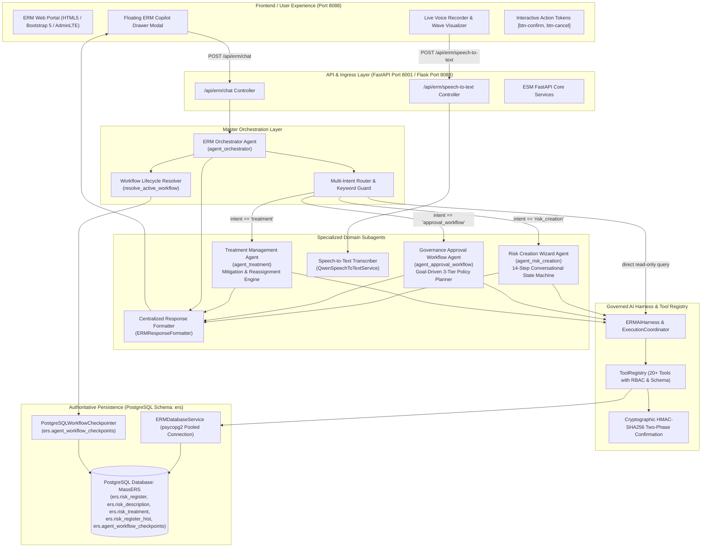

# 🏛️ ERM Copilot – System Architecture & Multi-Agent Ecosystem

---

## 📌 1. Executive Summary

**ERM Copilot** is an enterprise-grade, multi-agent AI copilot system designed specifically for Enterprise Risk Management (ERM). Operating within mission-critical industrial environments (petrochemicals, gas processing, power, refineries, and corporate governance), the Copilot coordinates specialized subagents to provide conversational risk creation, goal-driven 3-tier approvals, dynamic treatment lifecycle tracking, real-time heatmaps, audio transcription, and immutable audit trails.

The architecture follows a governed multi-agent model orchestrated by a central master agent, backed by a persistent PostgreSQL checkpoint store with optimistic concurrency, and governed by an enterprise AI harness with strict RBAC tool policies and cryptographic HMAC confirmation tokens.

---

## 🏛️ 2. High-Level Multi-Agent Architecture

---

## 📑 3. Dedicated Agent & Subsystem Documentation Index

Each subagent and core platform service in ERM Copilot is comprehensively documented in its own dedicated file:

| Document | Component / Agent | Primary Identity | Key Capabilities |
|---|---|---|---|
| [**01_ORCHESTRATOR_AGENT.md**](file:///d:/ERM/ERM_Copilot/docs/agents/01_ORCHESTRATOR_AGENT.md) | **Master Orchestrator Agent** | `agent_orchestrator` / `ERMOrchestratorAgent` | Active workflow resolution, draft suspension & resume, cross-agent intent switching matrix, 16 direct read-only tools, TTL caching. |
| [**02_RISK_CREATION_AGENT.md**](file:///d:/ERM/ERM_Copilot/docs/agents/02_RISK_CREATION_AGENT.md) | **Risk Creation Agent** | `agent_risk_creation` / `ConversationalRiskWizard` | 14-step conversational state machine, $5\times 5$ matrix scoring calculation, interactive UI picker chips, checkpoint persistence to `ers.agent_workflow_checkpoints`. |
| [**03_TREATMENT_MANAGEMENT_AGENT.md**](file:///d:/ERM/ERM_Copilot/docs/agents/03_TREATMENT_MANAGEMENT_AGENT.md) | **Treatment Management Agent** | `agent_treatment` / `TreatmentAgent` | Multi-turn mitigation task creation, progress tracking (0-100%), personnel reassignment, single/multi-turn parsers, HMAC-SHA256 confirmation tokens. |
| [**04_GOVERNANCE_APPROVAL_AGENT.md**](file:///d:/ERM/ERM_Copilot/docs/agents/04_GOVERNANCE_APPROVAL_AGENT.md) | **Governance Approval Agent** | `agent_approval_workflow` / `ApprovalWorkflowPlanner` | Dynamic policy planner, 3-tier sequence enforcement (FH $\to$ RM $\to$ RH), department isolation, mandatory rejection reasons, two-phase approval preview. |
| [**05_SPEECH_TO_TEXT_AGENT.md**](file:///d:/ERM/ERM_Copilot/docs/agents/05_SPEECH_TO_TEXT_AGENT.md) | **Speech-to-Text Transcriber** | `qwen_speech_service` / `QwenSpeechToTextService` | High-accuracy voice commands, Groq Whisper turbo + Gemini Multimodal Audio fallback, enterprise acoustic prompt biasing (`RSK-GAS-056`, etc.). |
| [**06_RESPONSE_FORMATTER_ENGINE.md**](file:///d:/ERM/ERM_Copilot/docs/agents/06_RESPONSE_FORMATTER_ENGINE.md) | **Response Formatter Engine** | `response_formatter` / `ERMResponseFormatter` | 17 standardized formatting methods, aligned tables, severity pills, status badges, action buttons micro-syntax (`[btn-confirm]`, `[btn-cancel]`), and CSS bindings. |
| [**07_AI_HARNESS_AND_TOOL_REGISTRY.md**](file:///d:/ERM/ERM_Copilot/docs/agents/07_AI_HARNESS_AND_TOOL_REGISTRY.md) | **AI Harness & Tool Registry** | `ERMAIHarness` / `ToolRegistry` | 20+ registered tools, strict RBAC permissions matrix, Pydantic JSON schema validation, two-phase confirmation tokens, execution audit logging. |
| [**08_WORKFLOW_CHECKPOINTER_AND_CONCURRENCY.md**](file:///d:/ERM/ERM_Copilot/docs/agents/08_WORKFLOW_CHECKPOINTER_AND_CONCURRENCY.md) | **Workflow Checkpointer** | `PostgreSQLWorkflowCheckpointer` | Schema `ers.agent_workflow_checkpoints`, optimistic concurrency with `version`, `SELECT ... FOR UPDATE` row locks, pause/resume transitions, and crash recovery. |

---

## 🛡️ 4. Role-Based Access Control (RBAC) Architecture

The platform enforces zero-trust role-based access control across all 7 ERM stakeholder personas:

| Role ID | Role Name | Code / Scope | Key Permitted Capabilities |
| :---: | :--- | :--- | :--- |
| **1** | **Risk Owner (RO)** | `risk_owner` (Dept) | Creates risks via 14-step wizard, evaluates $5\times 5$ scores, drafts mitigation plans, resubmits returned risks. |
| **2** | **Functional Head (FH)** | `functional_head` (Dept) | Stage 1 review: Approves department risks, returns with mandatory reason, assigns initial action owners. |
| **3** | **Risk Manager (RM)** | `risk_manager` (Enterprise) | Stage 2 review: Enterprise validation, audits 4-tier treatments, executes managerial sign-offs, reassigns owners. |
| **4** | **Risk Head / CRO (RH)** | `risk_head` (Enterprise) | Stage 3 final review: Executive sign-offs, monitors plant heatmaps, oversees risk velocity. |
| **5** | **Auditor** | `auditor` (Enterprise) | Read-only inspection of immutable audit trails (`ers.risk_register_hist`), timestamps, and user logs. |
| **6** | **Management / C-Suite** | `management` (Enterprise) | Executive visibility into departmental risk breakdowns, macro heatmaps, and high-severity plant hazards. |
| **7** | **ERM Admin** | `admin` (Enterprise) | System configuration, user-department mappings, and operational monitoring. |

---

## 🗄️ 5. Authoritative Database Layer

All workflows and Copilot mutations execute directly against **PostgreSQL** (`MassERS` database, `ers` schema):
- **`ers.agent_workflow_checkpoints`**: Authoritative checkpoint storage with optimistic concurrency (`version`), workflow state (`workflow_type`, `state_data`, `workflow_status`), and user bindings.
- **`ers.risk_register`**: Core risk records with status codes (`1` = Draft, `2` = Submitted to FH, `3` = FH Approved, `4` = RM Approved, `5` = Final Approved).
- **`ers.risk_description`**: Risk descriptions, causes, consequences, category mappings, and department associations.
- **`ers.risk_treatment`**: Action plans, assigned action owners, target dates, progress percentages, and status tracking.
- **`ers.risk_register_hist`**: Immutable append-only audit trail logging every approval, rejection, and state modification with timestamps and user IDs.
