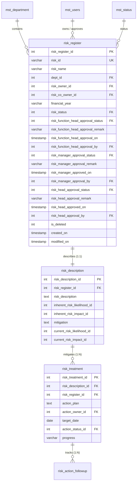

# 🗄️ Database & Schema Specifications

## 1. Database Connection & Environment Parameters

The ERM Copilot directly connects to the **MassERS** PostgreSQL database to guarantee sub-millisecond query response times and atomic write operations for critical approvals.

| Parameter | Environment Variable | Default Value | Notes |
| :--- | :--- | :--- | :--- |
| **Host** | `POSTGRES_HOST` | `localhost` | Database host server |
| **Port** | `POSTGRES_PORT` | `5433` | Dedicated PostgreSQL port for ERM |
| **Database** | `POSTGRES_DB_ERM` / `POSTGRES_DB` | `MassERS` | **Critical:** Must target `MassERS` (Schema: `ers`) |
| **User** | `POSTGRES_USER` | `postgres` | Database superuser/service account |
| **Password** | `POSTGRES_PASSWORD` | `Alethe@123` | Authentication secret |
| **Schema** | `DB_SCHEMA` | `ers` | All risk tables reside under `ers` schema |

---

## 2. Entity-Relationship Model (Schema: `ers`)



---

## 3. Key Table Definitions

### 3.1. `ers.risk_register`
Stores top-level risk header information and the full multi-tier governance approval lifecycle state:
- `risk_status`: Current lifecycle stage:
  - `1`: **Draft** (Created by Risk Owner)
  - `2`: **Submitted to Function Head** (Stage 2 Review)
  - `3`: **Function Head Approved** (Stage 3 Review - Risk Manager Queue)
  - `4`: **Risk Manager Approved** (Stage 4 Review - Risk Head / CRO Queue)
  - `5`: **Risk Head Approved (Final Sign-Off)**
- `risk_function_head_approval_*`: Approval status (`1`=Approved, `2`=Rejected), timestamp, approver user ID, and remarks.
- `risk_manager_approval_*`: Approval status, timestamp, approver user ID, and remarks.
- `risk_head_approval_*`: Final approval status, timestamp, approver user ID, and remarks.

### 3.2. `ers.risk_description`
Captures inherent and residual risk scores and baseline engineering mitigations:
- `inherent_risk_likelihood_id` (1–5) × `inherent_risk_impact_id` (1–5)
- `current_risk_likelihood_id` (1–5) × `current_risk_impact_id` (1–5)
- `mitigation`: Textual description of primary process/safety controls.

### 3.3. `ers.risk_treatment`
Captures specific action plans, milestones, and designated Action Owners:
- `action_plan`: Specific tactical maintenance/inspection action.
- `action_owner_id`: Foreign key referencing `ers.mst_users.id`.
- `target_date`: Milestone target completion date.
- `progress`: Percentage completion string (e.g. `45%`, `100%`).

### 3.4. `ers.agent_workflow_checkpoints` (Authoritative Agent Checkpoint Store)
Stores persistent conversational state, form drafts, and optimistic concurrency versioning for multi-turn AI workflows:
- `workflow_id`: Primary key UUID string (VARCHAR 64).
- `conversation_id`: Conversation identifier linking multi-turn message turns (VARCHAR 64).
- `session_id`: Client session identifier (VARCHAR 128).
- `owner_user_id`: Authenticated user ID owning the workflow (VARCHAR 64).
- `owner_role`: Authenticated role of the workflow owner (VARCHAR 64).
- `dept_id`: Department identifier associated with the workflow (INT).
- `workflow_type`: Target domain enum (`RISK_CREATION`, `TREATMENT`, `APPROVAL`, `LEGACY_APPROVAL`).
- `workflow_status`: Lifecycle status (`INITIATION`, `IN_PROGRESS`, `PAUSED`, `AWAITING_INPUT`, `COMPLETED`, `CANCELLED`, `EXPIRED`, `FAILED`).
- `current_agent`: Active subagent identifier (VARCHAR 64).
- `current_step`: Current step / phase identifier within the agent state machine (VARCHAR 64).
- `state_version`: Monotonically increasing integer supporting Optimistic Concurrency Control (INT NOT NULL DEFAULT 1).
- `state_payload`: Full serialized JSON text storing state variables, collected fields, draft payload, and history (TEXT NOT NULL).
- `created_at`: Checkpoint initialization timestamp (TIMESTAMP WITH TIME ZONE).
- `updated_at`: Last state modification timestamp (TIMESTAMP WITH TIME ZONE).
- `expires_at`: Absolute expiration timestamp enforcing session TTL (TIMESTAMP WITH TIME ZONE).

```sql
CREATE TABLE IF NOT EXISTS ers.agent_workflow_checkpoints (
    workflow_id VARCHAR(64) PRIMARY KEY,
    conversation_id VARCHAR(64) NOT NULL,
    session_id VARCHAR(128) NOT NULL,
    owner_user_id VARCHAR(64) NOT NULL,
    owner_role VARCHAR(64) NOT NULL,
    dept_id INT,
    workflow_type VARCHAR(64) NOT NULL,
    workflow_status VARCHAR(64) NOT NULL,
    current_agent VARCHAR(64) NOT NULL,
    current_step VARCHAR(64) NOT NULL,
    state_version INT NOT NULL DEFAULT 1,
    state_payload TEXT NOT NULL,
    created_at TIMESTAMP WITH TIME ZONE NOT NULL,
    updated_at TIMESTAMP WITH TIME ZONE NOT NULL,
    expires_at TIMESTAMP WITH TIME ZONE NOT NULL
);
CREATE INDEX IF NOT EXISTS idx_workflow_session ON ers.agent_workflow_checkpoints (session_id, workflow_status);
CREATE INDEX IF NOT EXISTS idx_workflow_owner ON ers.agent_workflow_checkpoints (owner_user_id);
CREATE INDEX IF NOT EXISTS idx_workflow_expires ON ers.agent_workflow_checkpoints (expires_at);
```

---

## 4. 5×5 Risk Scoring & Color Coding Matrix

$$ \text{Risk Score} = \text{Likelihood (1–5)} \times \text{Impact (1–5)} $$

| Score Range | Severity Tier | Color Code | Badge Representation | Required Governance Action |
| :---: | :---: | :---: | :---: | :--- |
| **15 – 25** | **Critical / Extreme** | `#FF0000` | `🔴 CRITICAL` | Immediate Executive Escalation & Emergency Mitigation |
| **10 – 14** | **High Risk** | `#FFA500` | `🟠 HIGH` | Priority Department Review & Mandatory Engineering Action |
| **5 – 9** | **Medium Risk** | `#FFFF00` | `🟡 MEDIUM` | Routine Maintenance Scheduling & Periodic Monitoring |
| **1 – 4** | **Low Risk** | `#008000` | `🟢 LOW` | Standard Operating Procedure (SOP) Adherence |
