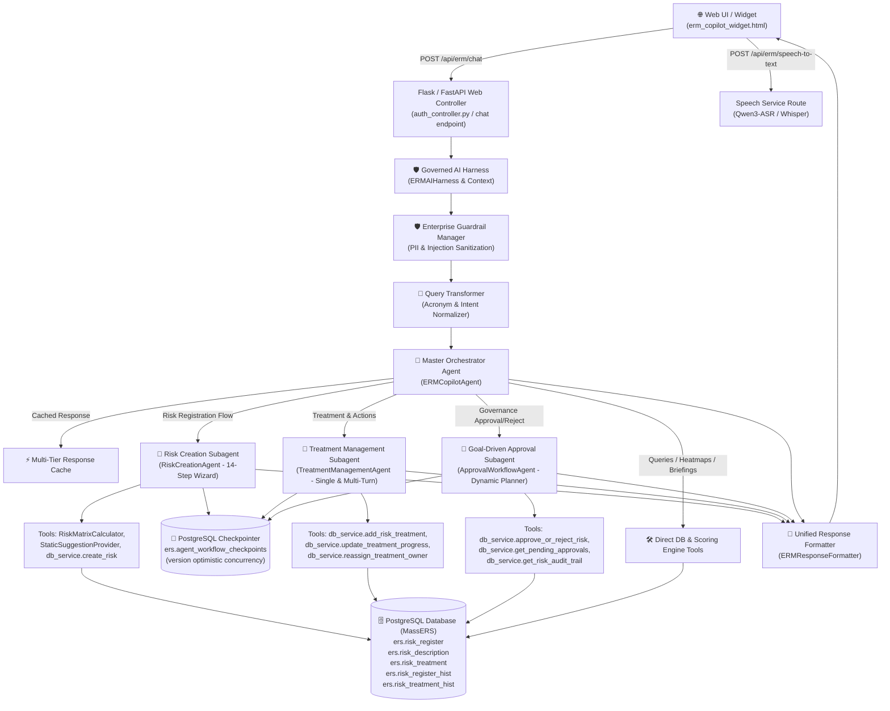

# 📚 ERM Copilot: Comprehensive Agents, Subagents, Tools & FastAPI Architecture Reference

---

## 🏛️ 1. Architecture Flow & Request Lifecycle

The diagram below illustrates the end-to-end flow from the frontend widget to the specialized subagents, tools, databases, and APIs.

---

## 🤖 2. Detailed Agent & Subagent Breakdown

### 👑 2.1 Master Orchestrator Agent (`ERMCopilotAgent`)
- **File Location:** [`ERM_Copilot/agents/orchestrator/agent.py`](file:///d:/ERM/ERM_Copilot/agents/orchestrator/agent.py)
- **Documentation:** [`docs/agents/01_ORCHESTRATOR_AGENT.md`](file:///d:/ERM/ERM_Copilot/docs/agents/01_ORCHESTRATOR_AGENT.md)
- **Role:** Central dispatcher for user prompts, role-based access control (RBAC), multi-tier response caching, and direct intent execution.
- **Key Capabilities:**
  - `resolve_active_workflow`: Discovers active drafts in memory or PostgreSQL checkpoints.
  - `_suspend_active_workflow`: Seamlessly pauses in-flight form drafts and invalidates pending confirmation tokens upon intent switch.
  - `search_risk_register`: Multi-criteria search across the enterprise risk catalog.
  - `get_risk_matrix_distribution`: Generates interactive 5×5 distribution grids.
  - `get_user_daily_briefing`: Personalized morning task overviews for each role.

---

### 📝 2.2 Risk Creation Wizard Subagent (`RiskCreationAgent`)
- **File Location:** [`ERM_Copilot/agents/risk_creation/agent.py`](file:///d:/ERM/ERM_Copilot/agents/risk_creation/agent.py)
- **Documentation:** [`docs/agents/02_RISK_CREATION_AGENT.md`](file:///d:/ERM/ERM_Copilot/docs/agents/02_RISK_CREATION_AGENT.md)
- **Architecture:** 14-Step Conversational State Machine with PostgreSQL draft checkpointing.
- **State Machine Steps:**
  1. `STEP_1_IDENTIFICATION`: Risk Title / Hazard name.
  2. `STEP_2_DEPARTMENT`: Department alignment validation.
  3. `STEP_3_CATEGORY`: Risk taxonomy categorization.
  4. `STEP_4_DESCRIPTION`: Hazard description narrative (with AI suggestions).
  5. `STEP_5_INHERENT_LIKELIHOOD`: Inherent Likelihood scale (1 to 5).
  6. `STEP_6_INHERENT_IMPACT`: Inherent Consequence scale (1 to 5).
  7. `STEP_7_EXISTING_CONTROLS`: Document baseline engineering/administrative controls.
  8. `STEP_8_CURRENT_LIKELIHOOD`: Residual post-control likelihood (1 to 5).
  9. `STEP_9_CURRENT_IMPACT`: Residual post-control consequence (1 to 5).
  10. `STEP_10_PROPOSED_MITIGATION`: Phased operational treatment strategy.
  11. `STEP_11_ACTION_OWNER`: Accountable department Action Owner.
  12. `STEP_12_TARGET_DATE`: Natural language date parser (`+30d`, `+60d`, `+90d`, ISO).
  13. `STEP_13_CONFIRMATION_PREVIEW`: Full compiled summary review with HMAC token.
  14. `STEP_14_PERSISTENCE`: Atomic database commit across `ers.risk_register` & `ers.risk_description`.

---

### 🛠️ 2.3 Treatment Management Subagent (`TreatmentManagementAgent`)
- **File Location:** [`ERM_Copilot/agents/treatment/agent.py`](file:///d:/ERM/ERM_Copilot/agents/treatment/agent.py)
- **Documentation:** [`docs/agents/03_TREATMENT_MANAGEMENT_AGENT.md`](file:///d:/ERM/ERM_Copilot/docs/agents/03_TREATMENT_MANAGEMENT_AGENT.md)
- **Role:** Mitigation action plan formulation, milestone execution progress tracking, and owner reassignments.
- **Operational Modes:**
  - **Add Treatment Plan:** Multi-turn wizard or single-turn formulation.
  - **Update Progress:** Instant natural language parsing (e.g. `Update progress of TRT-12 to 75%`).
  - **Reassign Action Owner:** Transfer ownership with department alignment validation.
  - **List Treatments:** Tabular overview of action plans attached to a risk.
- **Security & Integrity:**
  - HMAC-SHA256 signed confirmation tokens with 15-minute TTL.
  - Atomic single-use state `PENDING` $\to$ `EXECUTING` $\to$ `EXECUTED`.
  - Comprehensive audit logging in `ers.risk_treatment_hist` and `ers.risk_register_hist`.

---

### ⚖️ 2.4 Goal-Driven Governance Approval Subagent (`ApprovalWorkflowAgent`)
- **File Location:** [`ERM_Copilot/agents/approval_workflow/agent.py`](file:///d:/ERM/ERM_Copilot/agents/approval_workflow/agent.py)
- **Documentation:** [`docs/agents/04_GOVERNANCE_APPROVAL_AGENT.md`](file:///d:/ERM/ERM_Copilot/docs/agents/04_GOVERNANCE_APPROVAL_AGENT.md)
- **Architecture:** Goal-driven dynamic policy planner ([`ApprovalWorkflowPlanner`](file:///d:/ERM/ERM_Copilot/agents/approval_workflow/planner.py)) with bounded turn execution.
- **3-Tier Linear Hierarchy:**
  - **Functional Head (FH - Tier 1):** Advances `Status 2` (Submitted to FH) $\to$ `Status 3` (FH Approved). Enforces department isolation.
  - **Risk Manager (RM - Tier 2):** Advances `Status 3` $\to$ `Status 4` (RM Approved). Cannot bypass pending FH.
  - **Risk Head / CRO (RH - Tier 3):** Advances `Status 4` $\to$ `Status 5` (Approved) $\to$ `Pending for Action`.
- **Policy Guards:**
  - Rejections strictly require a **mandatory justification remark**.
  - Two-phase confirmation preview with HMAC anti-tamper verification.
  - Pre-execution state re-validation prevents duplicate sign-offs or acting on stale drafts.

---

### 🎙️ 2.5 Speech-to-Text Transcriber Service (`SpeechService`)
- **File Location:** [`ERM_Copilot/services/speech_service.py`](file:///d:/ERM/ERM_Copilot/services/speech_service.py)
- **Documentation:** [`docs/agents/05_SPEECH_TO_TEXT_AGENT.md`](file:///d:/ERM/ERM_Copilot/docs/agents/05_SPEECH_TO_TEXT_AGENT.md)
- **Role:** Real-time audio transcription with fallback cascade (Qwen3-Audio / Faster-Whisper $\to$ OpenAI Whisper API $\to$ Google Web Speech).

---

### 🎨 2.6 Centralized UI Response Formatter (`ERMResponseFormatter`)
- **File Location:** [`ERM_Copilot/formatters/response_formatter.py`](file:///d:/ERM/ERM_Copilot/formatters/response_formatter.py)
- **Documentation:** [`docs/agents/06_RESPONSE_FORMATTER_ENGINE.md`](file:///d:/ERM/ERM_Copilot/docs/agents/06_RESPONSE_FORMATTER_ENGINE.md)
- **Role:** Generates standardized markdown tables, badges, action buttons (`[btn:...]`, `[btn-confirm:...]`, `[btn-cancel:...]`), and UI event bus dispatchers.

---

### 🛡️ 2.7 Governed AI Harness & Tool Registry (`ERMAIHarness`)
- **File Location:** [`ERM_Copilot/ai_harness/`](file:///d:/ERM/ERM_Copilot/ai_harness/)
- **Documentation:** [`docs/agents/07_AI_HARNESS_AND_TOOL_REGISTRY.md`](file:///d:/ERM/ERM_Copilot/docs/agents/07_AI_HARNESS_AND_TOOL_REGISTRY.md)
- **Role:** Central gateway enforcing RBAC validation, schema checks, idempotency, retry policies, and HMAC confirmation tokens across 20+ enterprise tools.

---

### 💾 2.8 PostgreSQL Workflow Checkpointer (`PostgreSQLWorkflowCheckpointer`)
- **File Location:** [`ERM_Copilot/workflow/checkpointer.py`](file:///d:/ERM/ERM_Copilot/workflow/checkpointer.py)
- **Documentation:** [`docs/agents/08_WORKFLOW_CHECKPOINTER_AND_CONCURRENCY.md`](file:///d:/ERM/ERM_Copilot/docs/agents/08_WORKFLOW_CHECKPOINTER_AND_CONCURRENCY.md)
- **Authoritative Table:** `ers.agent_workflow_checkpoints`
- **Role:** Manages persistent state, optimistic concurrency (`version`), `SELECT ... FOR UPDATE` row locks, pause/resume transitions, and crash recovery.

---

## 🌐 3. FastAPI & Backend Endpoints Reference

| HTTP Method | Endpoint URL | Responsible Agent / Service | Request Payload | Response Schema | Description |
|---|---|---|---|---|---|
| `POST` | `/api/erm/chat` | `ERMCopilotAgent` via `ERMAIHarness` | `{"message": str, "role": str, "user_id": int, "dept_id": int, "dept_name": str}` | `AgentResponse` (`{response: str, metadata: dict}`) | Core conversational AI endpoint serving all 7 ERM roles. |
| `POST` | `/api/erm/speech-to-text` | `SpeechService` | `multipart/form-data` with `audio` file | `{"status": "success", "text": str}` | Transcribes user voice commands using Qwen3-ASR pipeline. |
| `POST` | `/api/erm/feedback` | `RLHF Feedback Engine` | `{"rating": int, "category": str, "user_id": int, "role": str}` | `{"status": "success", "feedback_id": str}` | Logs user feedback (👍/👎) for RLHF optimization. |
| `GET` | `/api/erm/feedback/stats` | `RLHF Feedback Engine` | None | `{"total_feedback": int, "satisfaction_rate": float}` | Aggregate telemetry of user satisfaction metrics. |
| `GET` | `/api/v1/risks` | `ERM_API Risk Service` | Query params: `dept_id`, `status`, `severity` | `List[RiskRegisterSchema]` | FastAPI core endpoint for listing risk items. |
| `POST` | `/api/v1/risks` | `ERM_API Risk Service` | `RiskCreateSchema` | `RiskDetailSchema` | FastAPI core endpoint for direct programmatic risk insertion. |
| `POST` | `/api/v1/risk-treatments/` | `ERM_API Treatment Service` | `TreatmentCreateSchema` | `TreatmentDetailSchema` | FastAPI core endpoint for action plan CRUD operations. |
| `POST` | `/api/v1/risks/governance-action` | `ERM_API Governance Service` | `{"risk_id": str, "action": str, "remark": str, "approver_id": int}` | `{"success": bool, "stage": str, "next_queue": str}` | FastAPI endpoint for executing 3-tier governance review steps. |

---

## 🔒 4. Security, Guardrails & RBAC Scopes

| ERM User Role | Governance Tier Scope | Permitted Actions |
|---|---|---|
| **Risk Owner (RO)** | Assigned Department | Formulate risks (14-step wizard), calculate inherent/residual matrix, add action plans, resubmit risks. |
| **Functional Head (FH)** | Governed Department | Review newly submitted department risks, approve to Stage 2, or reject for revision with mandatory remark. Department isolation enforced. |
| **Risk Manager (RM)** | Enterprise & Cross-Dept | Audit 4-tier matrix validation, approve to Stage 3 (Risk Head queue), or reject with remark. |
| **Risk Head / CRO (RH)** | Enterprise-Wide | Final Stage 4 executive sign-off, board risk exposure review, high-impact escalation. |
| **Action Owner (AO)** | Assigned Action Plans | Update milestone completion percentages, review target due dates, log progress remarks. |
| **Compliance Auditor** | Enterprise-Wide | Reconstruct immutable audit trails in `ers.risk_register_hist` and `ers.risk_treatment_hist`. |
| **Executive Management** | Enterprise-Wide | High-level plant hazard summaries, 5×5 exposure heatmaps, cross-department aggregation. |
