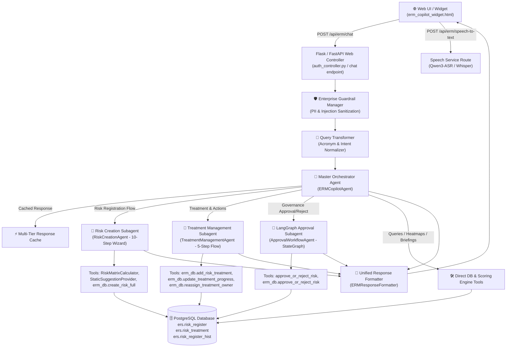

# 📚 ERM Copilot: Comprehensive Agents, Subagents, Tools & FastAPI Architecture Reference

---

## 🏛️ 1. Architecture Flow & Request Lifecycle

The diagram below illustrates the end-to-end flow from the frontend widget to the specialized subagents, tools, databases, and APIs.

---

## 🤖 2. Detailed Agent & Subagent Breakdown

### 👑 2.1 Master Orchestrator Agent (`ERMCopilotAgent`)
- **File Location:** [`d:/ERM/ERM_Copilot/agents/orchestrator/agent.py`](file:///d:/ERM/ERM_Copilot/agents/orchestrator/agent.py)
- **Role:** Central dispatcher for user prompts, role-based access control (RBAC), multi-tier response caching, and direct intent execution.
- **Capabilities:**
  - `search_risk_register`: Search risks by keyword, department, or severity.
  - `get_approval_queues`: Retrieve pending approval queues for FH, RM, and RH.
  - `get_risk_audit_trail`: Reconstruct full lifecycle audit timeline for a risk ID.
  - `calculate_risk_score`: Compute 5×5 matrix scores and severity bands.
  - `get_overdue_actions`: List overdue or open action plans.
  - `draft_risk_treatment`: Generate 4-tier industrial mitigation strategies.
  - `summarize_department_risks`: Aggregate enterprise-wide risk status by department.
  - `get_executive_dashboard`: Generate 5×5 interactive heatmap distributions.
  - `get_user_daily_briefing`: Generate morning briefings and personalized queues.

---

### 📝 2.2 Risk Creation Wizard Subagent (`RiskCreationAgent`)
- **File Location:** [`d:/ERM/ERM_Copilot/agents/risk_creation/agent.py`](file:///d:/ERM/ERM_Copilot/agents/risk_creation/agent.py)
- **Architecture:** 10-Step Deterministic Conversational State Machine.
- **State Machine Steps:**
  1. `AWAITING_RISK_NAME`: Captures Title / Hazard name.
  2. `AWAITING_CO_OWNER`: Dropdown selection of Enterprise Co-Owner.
  3. `AWAITING_DESCRIPTION`: Suggests 3 AI industrial hazard descriptions.
  4. `AWAITING_INHERENT_ASSESSMENT`: Dual dropdown 5×5 matrix score ($L \times I$).
  5. `AWAITING_MITIGATION`: Suggests 3 engineering & operational controls.
  6. `AWAITING_CURRENT_ASSESSMENT`: Residual 5×5 scoring after mitigation.
  7. `AWAITING_ACTION_PLAN`: Detailed phased action execution plan.
  8. `AWAITING_ACTION_OWNER`: Department dropdown of registered Action Owners.
  9. `AWAITING_TARGET_DATE`: Quick chip or custom date selection (`+30d`, `+60d`, `+90d`).
  10. `AWAITING_STATUS`: Draft Mode (Status 1) vs Submit to Functional Head (Status 2).
  11. `AWAITING_CONFIRMATION`: Final review card before database persistence.
- **Tools Used:**
  - `RiskMatrixCalculator`: Inherent and residual score matrix calculator (`scoring.py`).
  - `StaticSuggestionProvider`: Domain-tailored hazard, mitigation, and action plan suggestions (`suggestions.py`).
  - `erm_db.create_risk_full`: Inserts records atomically across `ers.risk_register`, `ers.risk_description`, and `ers.risk_treatment`.

---

### 🛠️ 2.3 Treatment Management Subagent (`TreatmentManagementAgent`)
- **File Location:** [`d:/ERM/ERM_Copilot/agents/treatment/agent.py`](file:///d:/ERM/ERM_Copilot/agents/treatment/agent.py)
- **Role:** Manages mitigation action plans, progress milestones, and owner reassignments for existing risks.
- **Sub-Workflows:**
  - **Add Treatment Plan (5 Steps):** Risk Selection $\rightarrow$ Action Plan $\rightarrow$ Action Owner $\rightarrow$ Target Date $\rightarrow$ Initial Progress $\rightarrow$ Database Save.
  - **Update Progress:** Instant or multi-turn progress update (e.g. `Update progress of TRT-12 to 75%`).
  - **Reassign Action Owner:** Department personnel selector and ownership transfer.
  - **List Treatments:** Tabular overview of all treatment plans attached to a risk.
- **Tools Used:**
  - `erm_db.add_risk_treatment`: Inserts new treatment row into `ers.risk_treatment`.
  - `erm_db.update_treatment_progress`: Updates percentage and status in `ers.risk_treatment`.
  - `erm_db.reassign_treatment_owner`: Updates `action_owner_id` in `ers.risk_treatment`.
  - `erm_db.get_risk_treatments`: Retrieves existing treatment plans for a risk.

---

### ⚖️ 2.4 LangGraph Governance Approval Subagent (`ApprovalWorkflowAgent`)
- **File Location:** [`d:/ERM/ERM_Copilot/agents/approval/graph.py`](file:///d:/ERM/ERM_Copilot/agents/approval/graph.py)
- **Architecture:** StateGraph with human-in-the-loop confirmation safety guard.
- **Nodes & Transitions:**
  - `extract_approval_request`: Extracts `risk_id`, `action` (`approve`/`reject`), and `remark`.
  - `validate_required_fields`: Checks missing parameters (prompts for remark or decision if absent).
  - `capture_continuation_input`: Handles follow-up conversational answers.
  - `execute_approval_tool`: Calls backend approval execution upon explicit confirmation.
- **Tools Used:**
  - `approve_or_reject_risk` ([`approval/tools.py`](file:///d:/ERM/ERM_Copilot/agents/approval/tools.py)): Enforces governance role hierarchy:
    - **Functional Head (FH):** Stage 1 $\rightarrow$ Status 3 (FH Approved).
    - **Risk Manager (RM):** Stage 2 $\rightarrow$ Status 4 (RM Approved).
    - **Risk Head / CRO (RH):** Stage 3 $\rightarrow$ Status 5 (Fully Approved).
  - Rejections transition risk back to Status 1 (Draft) with mandatory remark.
  - `erm_db.resubmit_risk`: Clears prior approval flags and resubmits to Stage 1.

---

### 🎙️ 2.5 Speech-to-Text Transcriber Service (`SpeechService`)
- **File Location:** [`d:/ERM/ERM_Copilot/services/speech_service.py`](file:///d:/ERM/ERM_Copilot/services/speech_service.py)
- **Role:** High-speed real-time audio transcription with fallback cascade:
  1. **Primary:** Qwen3-ASR / Faster-Whisper.
  2. **Secondary Fallback:** OpenAI Whisper API / Local Whisper Small.
  3. **Tertiary Fallback:** Google Web Speech Recognizer.

---

### 🎨 2.6 Centralized UI Response Formatter (`ERMResponseFormatter`)
- **File Location:** [`d:/ERM/ERM_Copilot/formatters/response_formatter.py`](file:///d:/ERM/ERM_Copilot/formatters/response_formatter.py)
- **Role:** Unifies all output formatting (tables, key-value cards, timeline audit trails, severity pills, and 1-click action buttons).

---

## 🌐 3. FastAPI & Backend Endpoints Reference

| HTTP Method | Endpoint URL | Responsible Agent / Service | Request Payload | Response Schema | Description |
|---|---|---|---|---|---|
| `POST` | `/api/erm/chat` | `ERMCopilotAgent` | `{"message": str, "role": str, "user_id": int, "dept_id": int, "dept_name": str}` | `AgentResponse` (`{response: str, metadata: dict}`) | Core conversational AI endpoint serving all 7 ERM roles. |
| `POST` | `/api/erm/speech-to-text` | `SpeechService` | `multipart/form-data` with `audio` file | `{"status": "success", "text": str}` | Transcribes user voice commands using Qwen3-ASR pipeline. |
| `POST` | `/api/erm/feedback` | `RLHF Feedback Engine` | `{"rating": int, "category": str, "user_id": int, "role": str, "dept_name": str}` | `{"status": "success", "feedback_id": str}` | Logs user feedback (👍/👎) for RLHF optimization. |
| `GET` | `/api/erm/feedback/stats` | `RLHF Feedback Engine` | None | `{"total_feedback": int, "satisfaction_rate": float}` | Aggregate telemetry of user satisfaction metrics. |
| `GET` | `/api/v1/risks` | `ERM_API Risk Service` | Query params: `dept_id`, `status`, `severity` | `List[RiskRegisterSchema]` | FastAPI core endpoint for listing risk items. |
| `POST` | `/api/v1/risks` | `ERM_API Risk Service` | `RiskCreateSchema` | `RiskDetailSchema` | FastAPI core endpoint for direct programmatic risk insertion. |
| `POST` | `/api/v1/risk-treatments/` | `ERM_API Treatment Service` | `TreatmentCreateSchema` | `TreatmentDetailSchema` | FastAPI core endpoint for action plan CRUD operations. |
| `POST` | `/api/v1/risks/governance-action` | `ERM_API Governance Service` | `{"risk_id": str, "action": str, "remark": str, "approver_id": int}` | `{"success": bool, "stage": str, "next_queue": str}` | FastAPI endpoint for executing 3-tier governance review steps. |

---

## 📊 4. Tools & Database Functions Matrix

| Tool / Function Name | Module Path | Input Parameters | Output Return Type | Invoked By |
|---|---|---|---|---|
| `search_risks` | `services/db_service.py` | `keyword: str, department: str, severity_level: str, limit: int` | `List[Dict[str, Any]]` | Orchestrator (`SEARCH_RISK`) |
| `get_pending_approvals` | `services/db_service.py` | `stage: str, dept_id: int, limit: int` | `List[Dict[str, Any]]` | Orchestrator (`APPROVAL_QUEUE`) |
| `get_risk_audit_trail` | `services/db_service.py` | `risk_id: str` | `Dict[str, Any]` (timeline + treatments) | Orchestrator (`AUDIT_TRAIL`) |
| `create_risk_full` | `services/db_service.py` | Risk fields dictionary (`risk_name`, `dept_id`, `l`, `i`, etc.) | `Dict[str, Any]` (`risk_id`, `status`) | `RiskCreationAgent` (Step 10) |
| `add_risk_treatment` | `services/db_service.py` | `risk_id, action_plan, action_owner_id, target_date, progress` | `Dict[str, Any]` (`risk_treatment_id`) | `TreatmentManagementAgent` |
| `update_treatment_progress`| `services/db_service.py` | `treatment_id, progress, status, remark` | `Dict[str, Any]` (`success: bool`) | `TreatmentManagementAgent` |
| `reassign_treatment_owner` | `services/db_service.py` | `treatment_id, new_owner_id` | `Dict[str, Any]` (`success: bool`) | `TreatmentManagementAgent` |
| `resubmit_risk` | `services/db_service.py` | `risk_id: str, user_id: int` | `Dict[str, Any]` (`stage, cleared: True`) | Orchestrator (`resubmit`) |
| `approve_or_reject_risk` | `agents/approval/tools.py` | `risk_id: str, action: str, remark: str, approver_id: int` | `Dict[str, Any]` (`success, next_queue`) | `ApprovalWorkflowAgent` |
| `get_risk_matrix_distribution` | `services/db_service.py` | `dept_id: int` | `Dict[str, Any]` (5x5 grid count) | Orchestrator (`HEATMAP_MATRIX`) |
| `get_user_daily_briefing` | `services/db_service.py` | `user_id: int, role_name: str, dept_id: int` | `Dict[str, Any]` (`pending_count, items`) | Orchestrator (`DAILY_BRIEFING`) |
| `transcribe_audio` | `services/speech_service.py` | `audio_bytes: bytes, filename: str` | `Dict[str, Any]` (`text: str`) | Speech API Route |

---

## 🔒 5. Security, Guardrails & RBAC Scopes

| ERM User Role | Governance Tier Scope | Permitted Actions |
|---|---|---|
| **Risk Owner (RO)** | Assigned Department | Formulate risks, calculate inherent/residual matrix, add action plans, resubmit risks. |
| **Functional Head (FH)** | Governed Department | Review newly submitted department risks, approve to Stage 2, or reject for revision. |
| **Risk Manager (RM)** | Enterprise & Cross-Dept | Audit 4-tier matrix validation, approve to Stage 3 (Risk Head queue), or reject. |
| **Risk Head / CRO (RH)** | Enterprise-Wide | Final Stage 4 executive sign-off, board risk exposure review, high-impact escalation. |
| **Action Owner (AO)** | Assigned Action Plans | Update milestone completion percentages, review target due dates, log progress remarks. |
| **Compliance Auditor** | Enterprise-Wide | Reconstruct immutable audit trails in `ers.risk_register_hist`, trace approval timestamps. |
| **Executive Management** | Enterprise-Wide | High-level plant hazard summaries, 5×5 exposure heatmaps, cross-department aggregation. |
