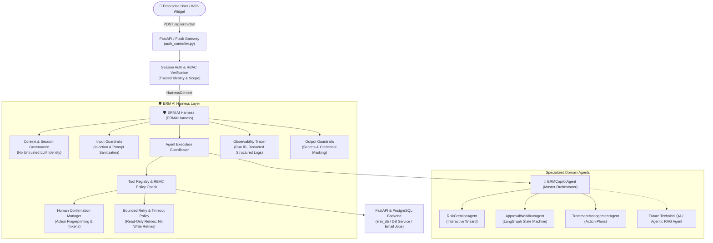

# 🛡️ ERM AI Harness: Architecture, Governance, and Integration Guide

This document describes the production **ERM AI Harness** integrated into the Enterprise Risk Management (ERM) Copilot system.

---

## 1. System Overview & Target Architecture

The **ERM AI Harness** serves as a lightweight, production-grade shared execution, security, observability, and tool governance layer wrapping the existing `ERMCopilotAgent` orchestrator, specialized agents (`RiskCreationAgent`, `TreatmentManagementAgent`, `ApprovalWorkflowAgent`), and domain tools.

---

## 2. Core Modules & Responsibilities

The harness is modularized within `ERM_Copilot/ai_harness/`:

| Module | Purpose & Invariants |
| :--- | :--- |
| **`context.py`** | `HarnessContext`: Immutable verified server-side identity (`user_id`, `user_role`, `dept_id`, `request_id`, `run_id`). Strictly isolates trusted session identity from untrusted user/LLM input. |
| **`policies.py`** | Role-to-tool RBAC policies (`ALL_ROLES`, `APPROVER_ROLES`, `CREATOR_ROLES`), stage sequence constraints (`Stage 2 FH` → `Stage 3 RM` → `Stage 4 RH`), and `is_role_authorized_for_tool` enforcement. |
| **`tool_registry.py`** | Centralized `ToolRegistry` maintaining `ToolDefinition` metadata, schemas, RBAC constraints, confirmation flags, timeout bounds, and handlers. |
| **`confirmation.py`** | `ConfirmationManager`: Generates deterministic SHA-256 action fingerprints and unique confirmation tokens; strictly prevents cross-action tampering or cross-user replay. |
| **`retry.py`** | `RetryPolicy`: Bounded exponential backoff exclusively for transient read-only failures. Strictly blocks automatic retries for state-changing write operations (`approve_or_reject_risk`, `save_risk`, etc.). |
| **`guardrails.py`** | `HarnessGuardrails`: Input prompt injection defense, output token/password redaction, and user/department isolated cache keys. |
| **`observability.py`** | `ObservabilityTracer` & `TraceSpan`: Structured runtime tracing with request/run correlation IDs and automatic credential redaction. |
| **`execution.py`** | `ExecutionCoordinator`: Orchestrates schema validation, RBAC checks, confirmation verification, timeouts, and governed execution. |
| **`harness.py`** | `ERMAIHarness`: Primary interface (`ERMAIHarness.run(context, message)`), handling cancellation commands, orchestrator delegation, and guardrails. |
| **`exceptions.py`** | Typed exception hierarchy (`AuthenticationError`, `AuthorizationError`, `ToolNotFoundError`, `ConfirmationRequiredError`, `ConfirmationMismatchError`, `GuardrailViolationError`, `BoundedExecutionError`, `NonIdempotentRetryError`). |

---

## 3. Human Confirmation & Security Lifecycle

For consequential state-changing operations (`approve_or_reject_risk`, `save_risk`, `add_risk_treatment`, `update_treatment_progress`, `resubmit_risk`):

1. **Preview & Mandatory Remarks**: User provides necessary decision parameters (e.g. Risk ID and mandatory remark).
2. **Fingerprint Creation**: The harness creates a pending confirmation object with a deterministic SHA-256 fingerprint:
   $$\text{Fingerprint} = \text{SHA-256}(\text{action} + \text{user\_id} + \text{risk\_id} + \text{canonical\_params})$$
3. **Confirmation Token**: A unique `conf-<uuid>` token is generated and bound to the session for 15 minutes.
4. **Explicit Signoff**: Execution occurs only after explicit confirmation matching the exact user and fingerprint.
5. **Cancellation**: If user types "cancel", "abort", or "stop", the pending token is discarded and marked `CANCELLED`.

---

## 4. Preservation of Enterprise Business Authority

- **Risk Scoring**: Always calculated via backend matrix (`5x5 Risk Matrix Calculator` / tables).
- **Sequence Verification**: Backend database service independently verifies current stage (`FH` → `RM` → `RH`) and rejects out-of-order attempts.
- **Audit & Email Dispatch**: PostgreSQL `risk_register_hist` audit records and asynchronous email triggers remain intact in backend services.
