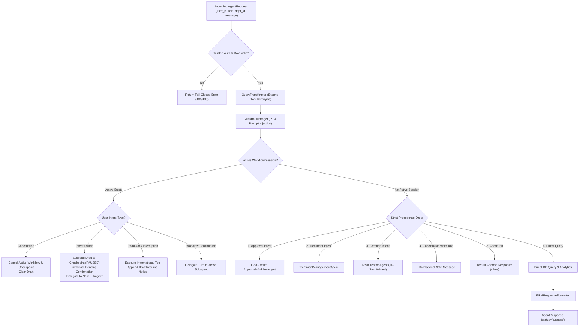

# 👑 Master Orchestrator Agent Documentation (`ERMCopilotAgent`)

---

## 📌 1. Overview & Identity

- **Class Name:** [`ERMCopilotAgent`](file:///d:/ERM/ERM_Copilot/agents/orchestrator/agent.py#L41)
- **File Location:** [`ERM_Copilot/agents/orchestrator/agent.py`](file:///d:/ERM/ERM_Copilot/agents/orchestrator/agent.py)
- **Agent ID:** `erm_copilot_agent`
- **Role:** Central AI Master Orchestrator for the Enterprise Risk Management (ERM) Platform.
- **Responsibilities:**
  - **Dynamic Routing & Precedence:** Routes user intents across specialized subagents ([`ApprovalWorkflowAgent`](file:///d:/ERM/ERM_Copilot/agents/approval_workflow/agent.py), [`TreatmentManagementAgent`](file:///d:/ERM/ERM_Copilot/agents/treatment/agent.py), [`RiskCreationAgent`](file:///d:/ERM/ERM_Copilot/agents/risk_creation/agent.py)) and direct informational tools.
  - **Session & Draft Lifecycle Management:** Seamlessly pauses active multi-turn drafts when users switch intent or ask read-only questions, preserving in-progress forms in [`ers.agent_workflow_checkpoints`](file:///d:/ERM/ERM_Copilot/workflow/checkpointer.py).
  - **Confirmation Invalidation:** Automatically invalidates pending confirmation tokens when an intent switch occurs, preventing accidental mutations.
  - **Fail-Closed Authentication & RBAC:** Enforces trusted user identity (`user_id`), validated roles across all 7 ERM roles, and strict department isolation before any domain logic executes.
  - **High-Speed Cache Pre-Routing:** Queries the multi-tier response cache ([`ERMResponseCache`](file:///d:/ERM/ERM_Copilot/cache/response_cache.py)) for sub-millisecond responses on repetitive queries.
  - **Enterprise Safety Guardrails:** Coordinates query expansion via [`QueryTransformer`](file:///d:/ERM/ERM_Copilot/transform/query_transformer.py) and input sanitization via [`GuardrailManager`](file:///d:/ERM/ERM_Copilot/guardrails/manager.py).

---

## 🏛️ 2. Execution & Precedence Architecture

The Master Orchestrator executes a rigorous 6-stage lifecycle for every incoming message:



---

## 🧭 3. Routing & Intent Switching Matrix

When an active session exists in memory or in PostgreSQL checkpoints, the orchestrator handles cross-agent messages safely:

| Current Active Session | User Message | Orchestrator Action | Resulting Workflow State |
| :--- | :--- | :--- | :--- |
| **Risk Creation Wizard** | `"Approve RSK-001 with remark OK"` | Pauses Risk Creation draft, invalidates wizard confirmation, routes to Approval Agent | Approval Agent processes command; Risk Creation draft saved in background |
| **Risk Creation Wizard** | `"Add treatment plan for RSK-001"` | Pauses Risk Creation draft, routes to Treatment Agent | Treatment Agent initiated; Risk Creation draft preserved |
| **Treatment Management** | `"Create a new risk for Gas Flare"` | Pauses Treatment draft, routes to Risk Creation Agent | Risk Creation wizard begins; Treatment draft preserved |
| **Any Active Workflow** | `"Show 5x5 heatmap"` / `"search risk"` | Executes read-only query directly, appends `📌 Draft Saved` reminder | Informational answer returned; workflow remains `PAUSED`/`IN_PROGRESS` |
| **Any Active Workflow** | `"cancel"` / `"quit"` / `"abort"` | Deletes memory session, marks checkpoint `CANCELLED` | Active draft discarded safely; cache cleared |

---

## 🛠️ 4. Tools & Database Functions Invoked

| Tool / Function | Implementation Module | Category | Description | Primary Inputs |
| :--- | :--- | :--- | :--- | :--- |
| [`search_risks`](file:///d:/ERM/ERM_Copilot/services/db_service.py#L320) | `services/db_service.py` | READ_ONLY | Multi-criteria risk search (keyword, dept, severity) | `keyword: str, dept_id: Optional[int], limit: int` |
| [`get_risk_matrix_distribution`](file:///d:/ERM/ERM_Copilot/services/db_service.py#L600) | `services/db_service.py` | READ_ONLY | Aggregates 5×5 Likelihood × Impact grid counts | `dept_id: Optional[int]` |
| [`get_user_daily_briefing`](file:///d:/ERM/ERM_Copilot/services/db_service.py#L120) | `services/db_service.py` | READ_ONLY | Generates personalized morning action briefing | `user_id: int, role_name: str, dept_id: int` |
| [`get_pending_approvals`](file:///d:/ERM/ERM_Copilot/services/db_service.py#L750) | `services/db_service.py` | READ_ONLY | Lists risks pending review in caller's queue | `approver_role: str, dept_id: Optional[int], limit: int` |
| [`get_risk_audit_trail`](file:///d:/ERM/ERM_Copilot/services/db_service.py#L850) | `services/db_service.py` | READ_ONLY | Reconstructs historical approvals & stage changes | `risk_identifier: str` |
| [`get_department_risk_summary`](file:///d:/ERM/ERM_Copilot/services/db_service.py#L1100) | `services/db_service.py` | READ_ONLY | Comprehensive status and progress breakdown by dept | `dept_id: Optional[int]` |
| [`get_overdue_actions`](file:///d:/ERM/ERM_Copilot/services/db_service.py#L1020) | `services/db_service.py` | READ_ONLY | Finds treatment milestones past their target date | `dept_id: Optional[int], limit: int` |
| [`resubmit_risk`](file:///d:/ERM/ERM_Copilot/services/db_service.py#L1300) | `services/db_service.py` | STATE_CHANGING | Resets rejected risk to Stage 1 after modification | `risk_id: str, user_id: int` |

---

## 🌐 5. Web Portal & API Contracts

### Chat Request Contract (`AgentRequest`)
```json
{
  "message": "Show high risks for Gas Processing",
  "user_id": "7",
  "user_role": "Functional Head",
  "session_id": "sess_web_7_abc123",
  "metadata": {
    "dept_id": 2,
    "dept_name": "Gas Processing Facilities"
  }
}
```

### Chat Response Contract (`AgentResponse`)
```json
{
  "request_id": "req-b89bdc53a47c",
  "agent_id": "erm_copilot_agent",
  "status": "success",
  "success": true,
  "response": "### 🛡️ Active Risk Register (Gas Processing Facilities)\n\n| Risk ID | Title | Severity | Status |\n| :--- | :--- | :--- | :--- |\n| `RSK-GAS-133` | Gas Leakage At Compressor Seal | 🔴 High (12) | Submitted to FH |\n\n[btn:Review RSK-GAS-133|Review RSK-GAS-133]",
  "metadata": {
    "intent": "SEARCH_RISKS",
    "role": "Functional Head",
    "scope": "Department ID: 2",
    "harness_governed": true,
    "timestamp": "2026-10-23T11:00:00Z"
  }
}
```
