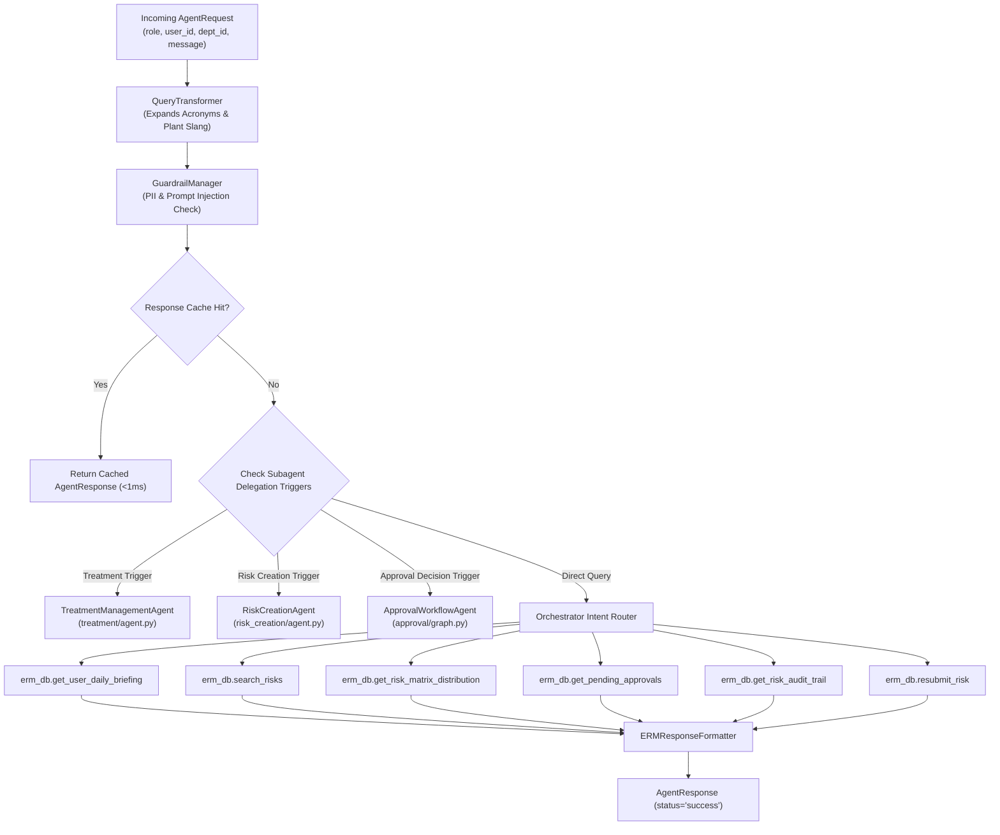

# 👑 Master Orchestrator Agent Documentation (`ERMCopilotAgent`)

---

## 📌 1. Overview & Identity
- **Class Name:** [`ERMCopilotAgent`](file:///d:/ERM/ERM_Copilot/agents/orchestrator/agent.py#L39)
- **File Location:** [`d:/ERM/ERM_Copilot/agents/orchestrator/agent.py`](file:///d:/ERM/ERM_Copilot/agents/orchestrator/agent.py)
- **Agent ID:** `erm_copilot_agent`
- **Role:** Master AI Orchestrator for the Enterprise Risk Management (ERM) system.
- **Responsibilities:**
  - Manages session lifecycle and user request dispatching across all 7 ERM roles.
  - Enforces Role-Based Access Control (RBAC) and department data scoping.
  - Coordinates input sanitization via Guardrails and query normalization via Query Transformer.
  - Queries multi-tier sub-millisecond response caches before executing database tools.
  - Delegates multi-turn specialized workflows to subagents (Risk Creation, Treatment, Approval).
  - Handles direct read queries: Risk Register search, 5×5 heatmaps, audit trails, department profiles, and morning briefings.

---

## 🏛️ 2. Execution & Delegation Architecture



---

## 🛠️ 3. Tools & Database Functions Invoked

| Tool / Function | Source Module | Purpose | Inputs | Output |
|---|---|---|---|---|
| `get_user_daily_briefing` | [`db_service.py`](file:///d:/ERM/ERM_Copilot/services/db_service.py) | Generates morning briefing of pending tasks | `user_id: int, role_name: str, dept_id: int` | `{"briefing_type": str, "pending_count": int, "items": list}` |
| `search_risks` | [`db_service.py`](file:///d:/ERM/ERM_Copilot/services/db_service.py) | Full-text and filtered risk register search | `keyword: str, department: str, severity_level: str, limit: int` | `List[Dict[str, Any]]` (active risks) |
| `get_risk_matrix_distribution`| [`db_service.py`](file:///d:/ERM/ERM_Copilot/services/db_service.py) | Computes 5×5 distribution grid count | `dept_id: Optional[int]` | `{"grid": dict, "total": int, "critical_count": int, ...}` |
| `get_pending_approvals` | [`db_service.py`](file:///d:/ERM/ERM_Copilot/services/db_service.py) | Retrieves department or enterprise queue | `stage: str, dept_id: Optional[int], limit: int` | `List[Dict[str, Any]]` |
| `get_risk_audit_trail` | [`db_service.py`](file:///d:/ERM/ERM_Copilot/services/db_service.py) | Reconstructs lifecycle approval history | `risk_id: str` | `{"created_on": str, "fh_status": int, "treatments": list, ...}` |
| `resubmit_risk` | [`db_service.py`](file:///d:/ERM/ERM_Copilot/services/db_service.py) | Clears prior approvals & resets to Stage 1 | `risk_id: str, user_id: int` | `{"success": bool, "stage": "Stage 1", "cleared": True}` |
| `get_department_risk_summary`| [`db_service.py`](file:///d:/ERM/ERM_Copilot/services/db_service.py) | Aggregates risk status by department | `dept_id: Optional[int]` | `List[Dict[str, Any]]` |
| `get_overdue_actions` | [`db_service.py`](file:///d:/ERM/ERM_Copilot/services/db_service.py) | Retrieves delayed treatment milestones | `dept_id: Optional[int], limit: int` | `List[Dict[str, Any]]` |

---

## 🌐 4. FastAPI & Web Endpoint Integration

### Primary Chat Endpoint
- **HTTP Method:** `POST`
- **Route:** `/api/erm/chat`
- **Controller Binding:** [`ERM_WEB_APP/app/controllers/web/auth_controller.py`](file:///d:/ERM/ERM_WEB_APP/app/controllers/web/auth_controller.py)
- **Request Payload:**
```json
{
  "message": "Show top open high-severity risks",
  "role": "Risk Owner",
  "user_id": 5,
  "dept_id": 2,
  "dept_name": "Gas Processing Facilities"
}
```
- **Response Payload (`AgentResponse`):**
```json
{
  "request_id": "req_1728300000",
  "agent_id": "erm_copilot_agent",
  "status": "success",
  "success": true,
  "response": "### 🛡️ Active Risk Register (Department: Gas Processing Facilities)\n\n| Risk ID | Risk Title & Description | Severity | Department | Current Status |\n...",
  "metadata": {
    "intent": "SEARCH_RISK",
    "role": "Risk Owner",
    "scope": "Department: Gas Processing Facilities",
    "context_used": true,
    "timestamp": "2026-10-07T11:40:00Z"
  }
}
```

---

## 🔒 5. Role-Based Scoping (RBAC)
- **Frontline Roles (Risk Owner, Action Owner, Functional Head):** Automatically filtered to their assigned department ID and department name (`filter_dept_id = dept_id`).
- **Enterprise Roles (Super Admin, Risk Head, Risk Manager, Auditor, Executive Management):** Global visibility across all enterprise departments (`filter_dept_id = None`).

---

## 🧪 6. Testing & Validation
- **Unit & Integration Test Suite:** [`ERM_Copilot/tests/test_suggestion_service.py`](file:///d:/ERM/ERM_Copilot/tests/test_suggestion_service.py) and [`test_governance_approval.py`](file:///d:/ERM/ERM_Copilot/tests/test_governance_approval.py).
- **CLI Test Command:** `python -m pytest ERM_Copilot/tests/ -v`
