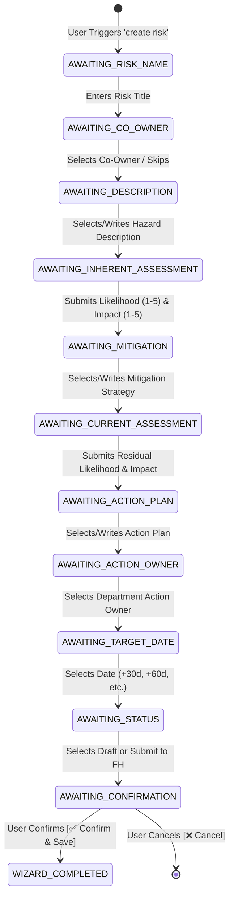

# 📝 Risk Creation Wizard Subagent Documentation (`RiskCreationAgent`)

---

## 📌 1. Overview & Identity
- **Class Name:** [`RiskCreationAgent`](file:///d:/ERM/ERM_Copilot/agents/risk_creation/agent.py#L25)
- **File Location:** [`d:/ERM/ERM_Copilot/agents/risk_creation/agent.py`](file:///d:/ERM/ERM_Copilot/agents/risk_creation/agent.py)
- **Agent ID:** `risk_creation_agent`
- **Role:** Interactive Conversational 10-Step Wizard for formulating, scoring, and saving new operational risks.
- **Trigger Phrases:** `"create risk"`, `"register risk"`, `"new risk"`, `"add risk"`, `"log a risk"`, `"formulate hazard"`.

---

## 🔄 2. 10-Step State Machine Workflow



---

## 📋 3. Step-by-Step Breakdown & User Interactions

| Step # | State Enum | Description & Interactive UI Component | Example Input / Button |
|---|---|---|---|
| **Step 1** | `AWAITING_RISK_NAME` | Prompts for the hazard / risk title. | `"Compressor High Vibration Risk"` |
| **Step 2** | `AWAITING_CO_OWNER` | Dropdown selector with registered enterprise users or Skip. | `[select:👤 Select Risk Co-Owner...\|...]` or `Skip` |
| **Step 3** | `AWAITING_DESCRIPTION` | Presents 3 AI industrial hazard suggestions. | `[btn:1️⃣ Option 1\|Option 1 Description]` |
| **Step 4** | `AWAITING_INHERENT_ASSESSMENT` | Interactive $5\times 5$ dual dropdown selector ($L \times I$). | `[assessment-matrix:inherent]` (e.g. $L=4, I=4 \rightarrow 16$) |
| **Step 5** | `AWAITING_MITIGATION` | Suggests 3 engineering & operational controls. | `[btn:1️⃣ Option 1: Engineering Control\|...]` |
| **Step 6** | `AWAITING_CURRENT_ASSESSMENT` | Residual $5\times 5$ dual dropdown selector after mitigation. | `[assessment-matrix:current]` (e.g. $L=2, I=2 \rightarrow 4$) |
| **Step 7** | `AWAITING_ACTION_PLAN` | Phased mitigation implementation plan. | `[btn:1️⃣ Option 1 Plan\|Option 1 Action Plan]` |
| **Step 8** | `AWAITING_ACTION_OWNER` | Dropdown of registered Action Owners for user's department. | `[select:👤 Select Action Owner...\|...]` |
| **Step 9** | `AWAITING_TARGET_DATE` | Timeline chips (`+30d`, `+60d`, `+90d`) or custom date. | `[btn:📅 +30 Days\|+30 days]` |
| **Step 10**| `AWAITING_STATUS` | Governance status choice (Draft vs Submit to FH). | `[btn:💾 Draft\|Draft]` / `[btn:🚀 Submit to FH\|Submit]` |
| **Review** | `AWAITING_CONFIRMATION` | Full compiled summary card with inline edit capabilities. | `[btn-confirm:✅ Confirm & Save\|Confirm]` |

---

## 🛠️ 4. Tools & Submodules

1. **`RiskMatrixCalculator`** ([`risk_creation/scoring.py`](file:///d:/ERM/ERM_Copilot/agents/risk_creation/scoring.py)):
   - Computes $Score = Likelihood \times Impact$.
   - Maps scores to standard ERM severity bands:
     - $15 - 25$: 🔴 **Critical**
     - $10 - 14$: 🟠 **High**
     - $5 - 9$: 🟡 **Medium**
     - $1 - 4$: 🟢 **Low**
2. **`StaticSuggestionProvider`** ([`risk_creation/suggestions.py`](file:///d:/ERM/ERM_Copilot/agents/risk_creation/suggestions.py)):
   - Generates contextual engineering, safety, and operational suggestions for descriptions, mitigations, and action plans.
3. **`erm_db.create_risk_full`** ([`services/db_service.py`](file:///d:/ERM/ERM_Copilot/services/db_service.py)):
   - Atomically inserts records across:
     - `ers.risk_register` (Risk ID, Department ID, User ID, Inherent & Residual ratings, Status).
     - `ers.risk_description` (Hazard Description & Mitigation details).
     - `ers.risk_treatment` (Action plan, Action owner, Target date, Progress).

---

## 🌐 5. FastAPI Endpoints & Payload Mapping

### Conversational Wizard Turn
- **Route:** `POST /api/erm/chat`
- **Request:**
```json
{
  "message": "Compressor Seal Leakage",
  "role": "Risk Owner",
  "user_id": 5,
  "dept_id": 2,
  "dept_name": "Gas Processing Facilities"
}
```

### Direct Programmatic Risk Creation (REST API)
- **Route:** `POST /api/v1/risks`
- **Controller:** [`ERM_API/app/api/risk_register.py`](file:///d:/ERM/ERM_API/app/api/risk_register.py)
- **Request Payload:**
```json
{
  "risk_name": "Compressor Seal Leakage",
  "department_id": 2,
  "inherent_likelihood": 4,
  "inherent_impact": 5,
  "current_likelihood": 2,
  "current_impact": 2,
  "status_id": 2,
  "description": "High pressure hydrogen gas leakage hazard.",
  "mitigation": "Install dual pressurized mechanical seal barrier system.",
  "action_plan": "Phase 1 seal overhaul and DCS vibration baseline calibration.",
  "action_owner_id": 8,
  "target_date": "2026-12-31"
}
```

---

## 🧪 6. Testing & Validation
- **Dedicated Test Suite:** [`ERM_Copilot/tests/test_risk_creation_agent.py`](file:///d:/ERM/ERM_Copilot/tests/test_risk_creation_agent.py) and [`test_risk_owner_e2e_creation.py`](file:///d:/ERM/ERM_Copilot/tests/test_risk_owner_e2e_creation.py).
- **Test Coverage:** All 14 steps, session isolation between concurrent users, inline field edits, matrix scoring, and cancellation.
