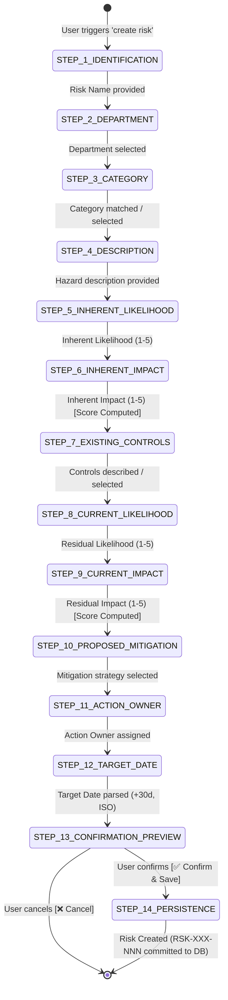

# 📝 Risk Creation Wizard Subagent Documentation (`RiskCreationAgent`)

---

## 📌 1. Overview & Identity

- **Class Name:** [`RiskCreationAgent`](file:///d:/ERM/ERM_Copilot/agents/risk_creation/agent.py#L25)
- **File Location:** [`ERM_Copilot/agents/risk_creation/agent.py`](file:///d:/ERM/ERM_Copilot/agents/risk_creation/agent.py)
- **Agent ID:** `risk_creation_agent`
- **Role:** Interactive Conversational 14-Step Wizard for formulating, scoring, mitigating, and persisting new operational risks.
- **Workflow Type:** `WorkflowType.RISK_CREATION`
- **Checkpoint Persistence:** Real-time state synchronization to [`ers.agent_workflow_checkpoints`](file:///d:/ERM/ERM_Copilot/workflow/checkpointer.py).
- **Trigger Phrases:**
  - `"create risk"`, `"register risk"`, `"new risk"`, `"add risk"`, `"log a risk"`
  - `"create a new operational risk for Gas Processing"`

---

## 🔄 2. 14-Step Conversational State Machine



---

## 📋 3. Step-by-Step Breakdown & Field Specifications

| Step # | Wizard Step Enum | Purpose | Interactive UI Component | Validation & Processing |
| :---: | :--- | :--- | :--- | :--- |
| **1** | `STEP_1_IDENTIFICATION` | Captures high-level risk title | Text input prompt | Rejects empty strings; strips special markdown characters |
| **2** | `STEP_2_DEPARTMENT` | Department alignment | Dropdown chips `[btn:GAS\|Gas Processing]` | Enforces user's assigned department if non-admin |
| **3** | `STEP_3_CATEGORY` | Risk Taxonomy categorization | Selection list (Operational, Safety, Financial, etc.) | Fuzzy category matcher ([`parsers.py`](file:///d:/ERM/ERM_Copilot/agents/risk_creation/parsers.py)) |
| **4** | `STEP_4_DESCRIPTION` | Detailed hazard narrative | 3 Dynamic AI-generated hazard options | Natural language input or 1-click option chips |
| **5** | `STEP_5_INHERENT_LIKELIHOOD` | Pre-control likelihood | Likelihood scale chips (1 to 5) | Integer range `[1, 5]` validation |
| **6** | `STEP_6_INHERENT_IMPACT` | Pre-control consequence | Impact scale chips (1 to 5) | Auto-computes inherent score ($L \times I$) and badge |
| **7** | `STEP_7_EXISTING_CONTROLS` | Document baseline controls | 3 AI control suggestions | Formats engineering barriers and inspection routines |
| **8** | `STEP_8_CURRENT_LIKELIHOOD` | Post-control residual likelihood | Likelihood scale chips (1 to 5) | Must be $\le$ Inherent Likelihood |
| **9** | `STEP_9_CURRENT_IMPACT` | Post-control residual consequence| Impact scale chips (1 to 5) | Auto-computes residual score ($L \times I$) and severity badge |
| **10**| `STEP_10_PROPOSED_MITIGATION` | Strategic treatment plan | 3 Phased engineering options | Actionable maintenance, overhaul, or monitoring tasks |
| **11**| `STEP_11_ACTION_OWNER` | Accountable personnel | User dropdown for department | Verifies user exists in `ers.mst_users` |
| **12**| `STEP_12_TARGET_DATE` | Target completion timeline | Quick chips (`+30 Days`, `+60 Days`, `+90 Days`) | [`parse_target_date`](file:///d:/ERM/ERM_Copilot/agents/risk_creation/parsers.py#L45) rejects past dates; formats ISO `YYYY-MM-DD` |
| **13**| `STEP_13_CONFIRMATION_PREVIEW`| Two-phase human review | Full markdown summary table | Generates HMAC-SHA256 signature; enables inline field edits |
| **14**| `STEP_14_PERSISTENCE` | Authoritative DB commit | Final confirmation card with risk ID | Executes `create_risk` tool; invalidates cache |

---

## 🧮 4. 5×5 Scoring Matrix & Dynamic Badges

Implements authoritative enterprise risk formula via [`RiskMatrixCalculator`](file:///d:/ERM/ERM_Copilot/agents/risk_creation/matrix.py):

$$ \text{Score} = \text{Likelihood (1--5)} \times \text{Impact (1--5)} $$

```
Impact ➔    1: Negligible   2: Minor     3: Moderate   4: Major      5: Catastrophic
Likelihood 🠓
5: Almost Certain  [5 - MED]     [10 - HIGH]  [15 - CRIT]   [20 - CRIT]   [25 - CRIT]
4: Likely          [4 - LOW]     [8 - MED]    [12 - HIGH]   [16 - CRIT]   [20 - CRIT]
3: Possible        [3 - LOW]     [6 - MED]    [9 - MED]     [12 - HIGH]   [15 - CRIT]
2: Unlikely        [2 - LOW]     [4 - LOW]    [6 - MED]     [8 - MED]     [10 - HIGH]
1: Rare            [1 - LOW]     [2 - LOW]    [3 - LOW]     [4 - LOW]     [5 - MED]
```

### Severity Bands & Color Badges
- **15 -- 25:** `🔴 CRITICAL` (Immediate functional head escalation required)
- **10 -- 14:** `🟠 HIGH` (Mandatory formal treatment plan required)
- **5 -- 9:** `🟡 MEDIUM` (Routine operational monitoring)
- **1 -- 4:** `🟢 LOW` (Standard operating procedures)

---

## 🛠️ 5. Tools & Database Functions Invoked

| Tool Name | Module | Type | Description |
| :--- | :--- | :--- | :--- |
| [`create_risk`](file:///d:/ERM/ERM_Copilot/services/db_service.py#L400) | `services/db_service.py` | STATE_CHANGING | Commits header to `ers.risk_register` and narrative to `ers.risk_description` in single atomic transaction. |
| [`calculate_risk_score`](file:///d:/ERM/ERM_Copilot/services/db_service.py#L550) | `services/db_service.py` | READ_ONLY | Authoritative backend validation of likelihood $\times$ impact score. |
| [`get_dropdown_options`](file:///d:/ERM/ERM_Copilot/services/db_service.py#L200) | `services/db_service.py` | READ_ONLY | Fetches registered departments, categories, and potential action owners. |

---

## 💾 6. Checkpoint Persistence & Recovery

When a user initiates the wizard, a persistent checkpoint is registered:
- **Table:** `ers.agent_workflow_checkpoints`
- **Workflow Type:** `RISK_CREATION`
- **Collected Fields:** Real-time JSON document tracking all 14 fields.
- **Inline Editing:** Before confirming Step 13, user can say `"Change likelihood to 3"` or `"Update target date to Dec 31"`; the agent updates `collected_fields` in place without restarting the wizard.
- **Crash Recovery:** If browser tab closes or process restarts, the session is reloaded at the exact step where the user paused.
