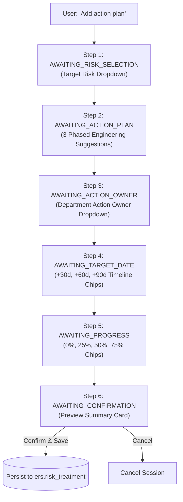

# 🛠️ Treatment Management Subagent Documentation (`TreatmentManagementAgent`)

---

## 📌 1. Overview & Identity
- **Class Name:** [`TreatmentManagementAgent`](file:///d:/ERM/ERM_Copilot/agents/treatment/agent.py#L24)
- **File Location:** [`d:/ERM/ERM_Copilot/agents/treatment/agent.py`](file:///d:/ERM/ERM_Copilot/agents/treatment/agent.py)
- **Agent ID:** `treatment_management_agent`
- **Role:** Specialized subagent for attaching new mitigation action plans, updating execution progress, and reassigning action owners for existing risk records.
- **Trigger Phrases:**
  - `"add action plan"`, `"add treatment"`, `"create action plan"`, `"mitigate risk"`
  - `"update progress"`, `"progress update"`, `"set progress to ..."`
  - `"reassign owner"`, `"transfer action"`, `"assign action to ..."`
  - `"list treatments"`, `"show action plans for ..."`

---

## 🔄 2. Sub-Workflows & State Machines

### 2.1 Add Treatment Plan Workflow (5 Steps)



### 2.2 Instant Single-Turn & Multi-Turn Progress Updates
- **Single-Turn Execution:** `"Update progress of TRT-12 to 75% with remark NDT completed"` $\rightarrow$ Directly calls `erm_db.update_treatment_progress` and confirms.
- **Multi-Turn Mode:** If target treatment or percentage is missing, prompts conversationally for the missing values.

### 2.3 Action Owner Reassignment
- Prompts for the designated department personnel and updates `action_owner_id` with audit logging.

---

## 🛠️ 3. Tools & Database Functions Invoked

| Function Name | Source Module | Inputs | Output Return | Purpose |
|---|---|---|---|---|
| `add_risk_treatment` | [`services/db_service.py`](file:///d:/ERM/ERM_Copilot/services/db_service.py) | `risk_id: str, action_plan: str, action_owner_id: int, target_date: str, progress: int, status: str` | `{"success": bool, "risk_treatment_id": int}` | Inserts new mitigation task into `ers.risk_treatment`. |
| `update_treatment_progress` | [`services/db_service.py`](file:///d:/ERM/ERM_Copilot/services/db_service.py) | `treatment_id: int, progress: int, status: str, remark: str` | `{"success": bool, "treatment_id": int, "new_progress": int}` | Updates milestone progress percentage and status. |
| `reassign_treatment_owner` | [`services/db_service.py`](file:///d:/ERM/ERM_Copilot/services/db_service.py) | `treatment_id: int, new_owner_id: int, remark: str` | `{"success": bool, "new_owner_name": str}` | Transfers ownership of an existing action plan. |
| `get_risk_treatments` | [`services/db_service.py`](file:///d:/ERM/ERM_Copilot/services/db_service.py) | `risk_id: str` | `List[Dict[str, Any]]` | Retrieves all active treatment plans for a specific risk. |
| `get_department_action_owners` | [`services/db_service.py`](file:///d:/ERM/ERM_Copilot/services/db_service.py) | `dept_id: int, dept_name: str` | `List[Dict[str, Any]]` | Returns registered Action Owners in the department. |

---

## 🌐 4. FastAPI & REST API Endpoints

### Conversational Treatment Turn
- **Route:** `POST /api/erm/chat`
- **Request:**
```json
{
  "message": "Add action plan to RSK-GAS-049",
  "role": "Action Owner",
  "user_id": 8,
  "dept_id": 2,
  "dept_name": "Gas Processing Facilities"
}
```

### Direct Programmatic CRUD (REST API)
- **Create Treatment:** `POST /api/v1/risk-treatments/`
- **Update Treatment:** `PUT /api/v1/risk-treatments/{id}`
- **Delete Treatment:** `DELETE /api/v1/risk-treatments/{id}`
- **Controller File:** [`ERM_API/app/api/risk_treatment.py`](file:///d:/ERM/ERM_API/app/api/risk_treatment.py)
- **Request Schema (`TreatmentCreateSchema`):**
```json
{
  "risk_id": 49,
  "action_plan": "Install automated safety interlocks and calibrate alarm setpoints.",
  "action_owner_id": 8,
  "target_date": "2026-11-30",
  "progress": 25,
  "status_id": 1
}
```

---

## 🧪 5. Testing & Validation
- **Dedicated Test Suite:** [`ERM_Copilot/tests/test_treatment_management_agent.py`](file:///d:/ERM/ERM_Copilot/tests/test_treatment_management_agent.py).
- **Test Coverage:** Multi-turn addition, cancellation, listing treatments, regex trigger recognition, and progress parsing.
