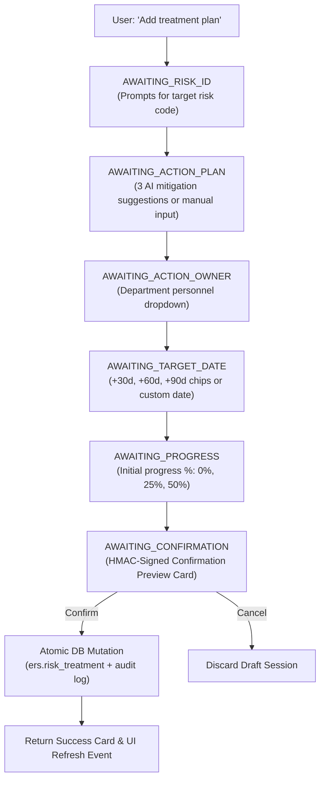

# 🛠️ Treatment Management Subagent Documentation (`TreatmentManagementAgent`)

---

## 📌 1. Overview & Identity

- **Class Name:** [`TreatmentManagementAgent`](file:///d:/ERM/ERM_Copilot/agents/treatment/agent.py#L24)
- **File Location:** [`ERM_Copilot/agents/treatment/agent.py`](file:///d:/ERM/ERM_Copilot/agents/treatment/agent.py)
- **Agent ID:** `treatment_management_agent`
- **Role:** Specialized subagent for formulating risk mitigation action plans, tracking milestone execution progress, and reassigning action owners.
- **Workflow Type:** `WorkflowType.TREATMENT_MANAGEMENT`
- **Supported Operational Modes:**
  1. **Interactive Multi-Turn Wizard:** Conversational step-by-step collection when parameters are missing.
  2. **High-Speed Single-Turn Commands:** Direct natural language mutations with confirmation gating (e.g., `"Update progress of TRT-168 to 50% with remark seal overhauled"`).
  3. **Read-Only Inquiries:** Browsing active treatments, audit timelines, and overdue milestones.

---

## 🔄 2. Workflows & State Machines

### 2.1 Multi-Turn "Add Treatment" Flow



### 2.2 Instant Single-Turn Parsing
When user supplies all parameters in one command:
- `"Update progress of TRT-101 to 75%"` $\to$ parses treatment ID `101`, progress `75`, prompts directly for confirmation preview.
- `"Reassign TRT-101 to Rohan Deshmukh because of engineer rotation"` $\to$ parses target owner and reason, verifies department alignment, and generates confirmation preview.

---

## 🛠️ 3. Authoritative Tools & Database Functions

The Treatment Management Agent interacts with the database exclusively through the governed AI Harness:

| Tool / Service API | Implementation Function | Category | Primary Service Arguments | Output Return |
| :--- | :--- | :--- | :--- | :--- |
| **`add_risk_treatment`** | [`db_service.add_risk_treatment`](../services/db_service.py) | STATE_CHANGING | `risk_register_id: int, action_plan: str, action_owner_id: int, target_date: Optional[str] = None, progress: int = 0, action_status_id: int = 1, created_by: int = 1` | `{"status": "success", "risk_treatment_id": int, "risk_register_id": int, ...}` |
| **`update_treatment_progress`** | [`db_service.update_treatment_progress`](../services/db_service.py) | STATE_CHANGING | `treatment_id: int, progress: int, modified_by: int = 1, remarks: Optional[str] = None` | `{"status": "success", "risk_treatment_id": int, "progress": str, "status_label": str, ...}` |
| **`reassign_treatment_owner`** | [`db_service.reassign_treatment_owner`](../services/db_service.py) | STATE_CHANGING | `treatment_id: int, new_action_owner_id: int, modified_by: int = 1` | `{"status": "success", "risk_treatment_id": int, "action_owner_id": int, "action_owner_name": str, ...}` |
| **`list_risk_treatments`** | [`db_service.get_treatments_for_risk`](../services/db_service.py) | READ_ONLY | `risk_ident: Union[int, str], dept_id: Optional[int] = None` | `List[Dict[str, Any]]` |
| **`get_treatment_details`** | [`db_service.get_treatment_by_id`](../services/db_service.py) | READ_ONLY | `treatment_id: int` | `Optional[Dict[str, Any]]` |

---

## 🛡️ 4. Security, HMAC Token Binding & Cross-Department Isolation

### 4.1 HMAC-SHA256 Token Binding
Every state-changing treatment mutation produces a signed confirmation token:
```python
token = hmac.new(
    SECRET_KEY.encode(),
    f"{actor_id}:{actor_role}:{action}:{target_id}:{canonical_args}:{expires_at}".encode(),
    hashlib.sha256
).hexdigest()
```
- **Actor Binding:** Token can only be consumed by the identical authenticated user and role that requested it.
- **Payload Anti-Tamper:** Modifying progress from `50%` to `100%` during confirmation invalidates the HMAC signature and causes immediate rejection.
- **Single-Use Enforcement:** Status transitions atomically `PENDING` $\to$ `EXECUTING` $\to$ `EXECUTED`. Replays and concurrent clicks are blocked.
- **15-Minute Expiration:** Expired tokens cannot be executed after a process restart.

### 4.2 Cross-Department Isolation (Fail Closed)
- Frontline Action Owners and Functional Heads can **only** add treatments, update progress, or reassign owners within their assigned department.
- If user `dept_id != risk.dept_id`, the action is blocked with:
  > `⛔ Department Access Restriction: Cannot modify treatments across departmental boundaries.`

### 4.3 Comprehensive Audit Trail History
- **`ers.risk_treatment_hist`:** Records every progress update, previous progress %, new progress %, prior owner, new owner, and user remark.
- **`ers.risk_register_hist`:** Logs treatment milestone additions against the parent risk record.
