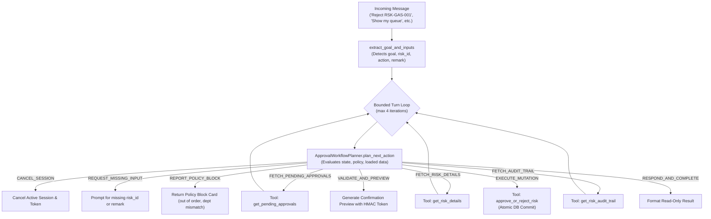

# ⚖️ Goal-Driven Governance Approval Subagent Documentation (`ApprovalWorkflowAgent`)

---

## 📌 1. Overview & Identity

- **Class Name:** [`ApprovalWorkflowAgent`](file:///d:/ERM/ERM_Copilot/agents/approval_workflow/agent.py#L55)
- **File Location:** [`ERM_Copilot/agents/approval_workflow/agent.py`](file:///d:/ERM/ERM_Copilot/agents/approval_workflow/agent.py)
- **Agent ID:** `agent_approval_workflow`
- **Role:** Goal-driven, policy-aware subagent responsible for governance reviews, queue inspections, audit trail reconstruction, and 3-tier linear approvals/rejections.
- **Workflow Type:** `WorkflowType.APPROVAL_GOVERNANCE`
- **Supported Goals ([`ApprovalGoal`](file:///d:/ERM/ERM_Copilot/agents/approval_workflow/state.py#L12)):**
  1. `SHOW_PENDING_APPROVALS`: Displays department or enterprise approval queue.
  2. `SHOW_RISK_DETAILS`: Retrieves comprehensive risk profile for review.
  3. `SHOW_AUDIT_TRAIL`: Displays timestamped history of approvals and status transitions.
  4. `CHECK_STATUS`: Pre-evaluates whether caller is currently eligible to approve.
  5. `APPROVE_RISK`: Advances risk to the next governance stage.
  6. `REJECT_RISK`: Returns risk to Draft status with mandatory justification reason.

---

## 🏛️ 2. Goal-Driven Planner Architecture

Rather than hardcoded multi-turn state branches, this agent utilizes a dynamic policy planner ([`ApprovalWorkflowPlanner`](file:///d:/ERM/ERM_Copilot/agents/approval_workflow/planner.py)) bounded to a maximum of 4 evaluation turns per user request:



---

## 📋 3. 3-Tier Linear Governance Hierarchy

Risk sign-offs follow a strict, non-bypassable 3-tier linear hierarchy:

```mermaid
flowchart LR
    S2["Status 2: Submitted to FH\n(Frontline Risk Created)"] -->|Stage 1: Functional Head Review\n(Dept isolation enforced)| S3["Status 3: FH Approved\n(Dept review complete)"]
    S3 -->|Stage 2: Risk Manager Review\n(Cross-dept review)| S4["Status 4: RM Approved\n(Risk office review complete)"]
    S4 -->|Stage 3: Risk Head Review\n(Board level sign-off)| S5["Status 5: Fully Approved\n(Pending for Action)"]
    
    S2 -.->|Reject with Remark| S1["Status 1: Draft\n(Returned for Revision)"]
    S3 -.->|Reject with Remark| S1
    S4 -.->|Reject with Remark| S1
```

### Stage Validation Rules:
1. **Functional Head (Tier 1):**
   - Can only review risks currently at `Status 2` (`risk_function_head_approval_status == 0`).
   - **Department Isolation:** `user.dept_id == risk.dept_id` is mandatory. Rejects cross-department reviews immediately.
2. **Risk Manager (Tier 2):**
   - Can only review risks currently at `Status 3` (`risk_function_head_approval_status == 1` and `risk_manager_approval_status == 0`).
   - Cannot bypass pending Functional Head review.
3. **Risk Head (Tier 3):**
   - Can only review risks currently at `Status 4` (`risk_manager_approval_status == 1` and `risk_head_approval_status == 0`).
   - Final sign-off transitions `risk_status` to `5` (Approved) and next queue to `Pending for Action`.

---

## 🛡️ 4. Governance Policies & Safety Guards

1. **Mandatory Rejection Remark:**
   - Any rejection command without a reason (e.g., `"Reject RSK-GAS-001"`) is intercepted by the planner before validation. The agent transitions to `AWAITING_REMARK` and prompts:
     > `### ⚠️ Rejection Reason Required: Please provide the reason for rejecting risk RSK-GAS-001.`
2. **Two-Phase Confirmation Preview:**
   - No approval or rejection is ever executed directly on a first turn. The agent first displays a markdown summary table detailing:
     - Target Risk ID and Title
     - Governance Stage and Role
     - Proposed Decision (Approve vs Reject)
     - Recorded Remark
   - Includes action buttons: `[btn-confirm:✅ Confirm Sign-Off|confirm approve]` and `[btn-cancel:❌ Cancel|cancel]`.
3. **Pre-Execution Revalidation:**
   - Before executing the database tool upon confirmation, the agent re-fetches the latest risk state to ensure another user did not already approve, reject, or modify the risk in the interim.
4. **Non-Approver Block:**
   - Frontline users (e.g. `Risk Owner`, `Action Owner`, `Auditor`) attempting to approve or reject receive an immediate fail-closed policy block without database mutation.

---

## 🛠️ 5. Authoritative Tools & Database Functions

| Tool Name | Implementation Function | Type | Description | Inputs |
| :--- | :--- | :--- | :--- | :--- |
| **`approve_or_reject_risk`** | [`db_service.approve_or_reject_risk`](file:///d:/ERM/ERM_Copilot/services/db_service.py#L700) | STATE_CHANGING | Commits sequential approval or rejection, updates status flags, and records history. | `risk_id: str, approver_id: int, action: str, remark: Optional[str]` |
| **`get_pending_approvals`** | [`db_service.get_pending_approvals`](file:///d:/ERM/ERM_Copilot/services/db_service.py#L750) | READ_ONLY | Retrieves pending queue filtered by approver's tier and department scope. | `approver_role: str, dept_id: Optional[int], limit: int` |
| **`get_risk_details`** | [`db_service.get_risk_by_code`](file:///d:/ERM/ERM_Copilot/services/db_service.py#L320) | READ_ONLY | Retrieves full risk record including current lifecycle and approval flags. | `risk_id: str, dept_id: Optional[int]` |
| **`get_risk_audit_trail`** | [`db_service.get_risk_audit_trail`](file:///d:/ERM/ERM_Copilot/services/db_service.py#L850) | READ_ONLY | Reconstructs historical approvals, timestamps, and approver names. | `risk_identifier: str` |
