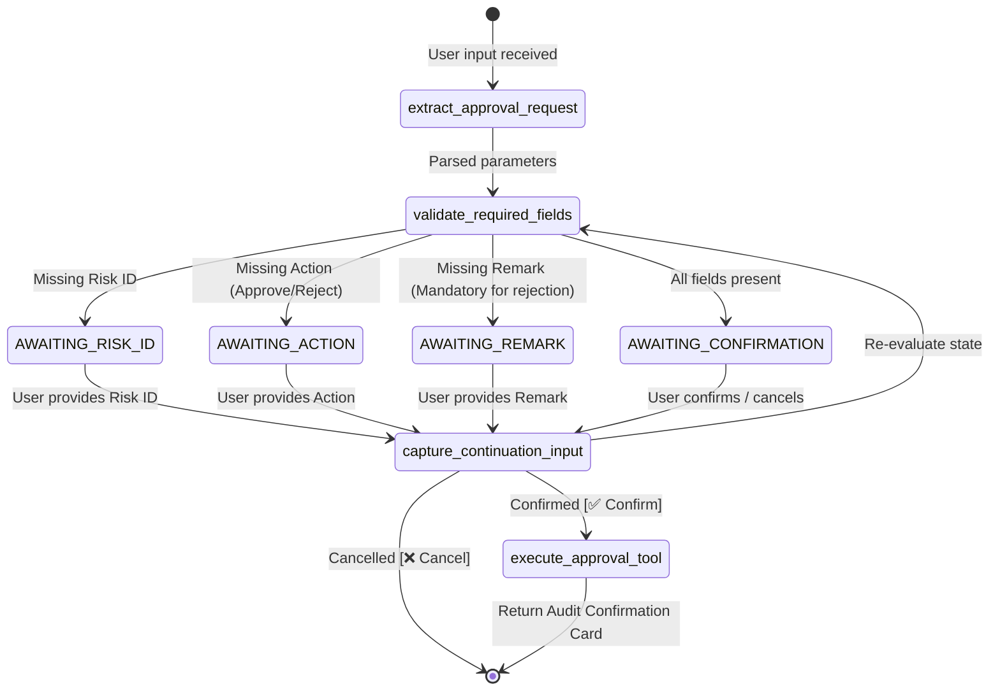
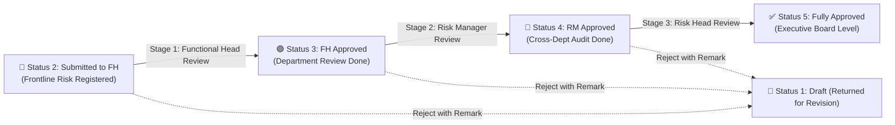

# ⚖️ LangGraph Governance Approval Subagent Documentation (`ApprovalWorkflowAgent`)

---

## 📌 1. Overview & Identity
- **Class Name:** [`ApprovalWorkflowAgent`](file:///d:/ERM/ERM_Copilot/agents/approval/graph.py#L103)
- **File Location:** [`d:/ERM/ERM_Copilot/agents/approval/graph.py`](file:///d:/ERM/ERM_Copilot/agents/approval/graph.py)
- **Agent ID:** `agent_approval_langgraph_v1`
- **Role:** Deterministic LangGraph StateGraph agent for multi-turn governance approval and rejection decisions with 3-tier sequence validation and human confirmation guards.
- **Trigger Phrases:**
  - `"approve RSK-GAS-087"`, `"i want to approve this risk RSK-GAS-087 with remark is ok good"`
  - `"reject RSK-REF-001"`, `"return for revision"`
  - `"confirm approve"`, `"confirm rejection"`

---

## 🏛️ 2. LangGraph StateGraph Architecture



---

## 📋 3. 3-Tier Governance Stage Sequence

The governance engine strictly validates the sequential progression of risk sign-offs:



### Governance Hierarchy Rules:
1. **Functional Head (FH):** Reviews risks in `Status 2` (Submitted to FH) $\rightarrow$ Advances to `Status 3` (FH Approved).
2. **Risk Manager (RM):** Reviews risks in `Status 3` (FH Approved) $\rightarrow$ Advances to `Status 4` (RM Approved). *Cannot bypass pending FH review.*
3. **Risk Head / CRO (RH):** Reviews risks in `Status 4` (RM Approved) $\rightarrow$ Advances to `Status 5` (Approved). *Cannot bypass pending RM review.*
4. **Rejection Policy:** Any approver can reject a risk with a mandatory remark $\rightarrow$ Resets status to `Status 1` (Draft) and clears previous stage flags.

---

## 🛠️ 4. Tools & State Nodes

| Node / Tool | Source File | Description | Inputs | Output |
|---|---|---|---|---|
| `extract_approval_request` | [`approval/nodes.py`](file:///d:/ERM/ERM_Copilot/agents/approval/nodes.py#L84) | Regex & NLP parsing of `risk_id`, `action`, `remark` | `ApprovalState` | Updated `ApprovalState` |
| `validate_required_fields` | [`approval/nodes.py`](file:///d:/ERM/ERM_Copilot/agents/approval/nodes.py#L113) | Evaluates completeness of decision parameters | `ApprovalState` | Next routing decision / prompt |
| `capture_continuation_input`| [`approval/nodes.py`](file:///d:/ERM/ERM_Copilot/agents/approval/nodes.py#L155) | Merges follow-up messages into session | `ApprovalState` | Updated `ApprovalState` |
| `execute_approval_tool` | [`approval/nodes.py`](file:///d:/ERM/ERM_Copilot/agents/approval/nodes.py#L232) | Invokes `approve_or_reject_risk` tool | `ApprovalState` | Final persisted result & audit card |
| `approve_or_reject_risk` | [`approval/tools.py`](file:///d:/ERM/ERM_Copilot/agents/approval/tools.py) | Executes governance transition in database | `risk_id, action, remark, approver_id` | `{"success": bool, "stage": str, ...}` |

---

## 🌐 5. FastAPI Endpoints

### Conversational Approval Turn
- **Route:** `POST /api/erm/chat`
- **Request:**
```json
{
  "message": "i want to approve this risk RSK-GAS-087 with remark is ok good",
  "role": "Functional Head",
  "user_id": 4,
  "dept_id": 2,
  "dept_name": "Gas Processing Facilities"
}
```
- **Response:**
```json
{
  "request_id": "req_1728300001",
  "agent_id": "agent_approval_langgraph_v1",
  "status": "success",
  "success": true,
  "response": "### 📋 Risk Approval Summary\n\n| Parameter | Details |\n| :--- | :--- |\n| **Risk ID** | `RSK-GAS-087` |\n| **Decision** | ✅ **Approve** |\n| **Recorded Remark** | *\"ok good\"* |\n\nDo you want to confirm this approve?\n\n[btn-confirm:✅ Confirm Approval|confirm approve] [btn-cancel:❌ Cancel|cancel]",
  "metadata": {
    "intent": "AWAITING_CONFIRMATION",
    "risk_id": "RSK-GAS-087",
    "action": "approve",
    "remark": "ok good"
  }
}
```

### Direct Governance Action (REST API)
- **Route:** `POST /api/v1/risks/governance-action`
- **Controller File:** [`ERM_API/app/api/risk_register.py`](file:///d:/ERM/ERM_API/app/api/risk_register.py)
- **Request Payload:**
```json
{
  "risk_id": "RSK-GAS-087",
  "action": "approve",
  "remark": "All controls verified and residual risk is acceptable.",
  "approver_id": 4
}
```

---

## 🧪 6. Testing & Validation
- **Dedicated Test Suites:** 
  - [`ERM_Copilot/tests/test_governance_approval.py`](file:///d:/ERM/ERM_Copilot/tests/test_governance_approval.py) (RBAC, hierarchy enforcement, empty remark rejection).
  - [`ERM_Copilot/tests/test_langgraph_approval_workflow.py`](file:///d:/ERM/ERM_Copilot/tests/test_langgraph_approval_workflow.py) (All 16 workflow states and conversational turn transitions).
