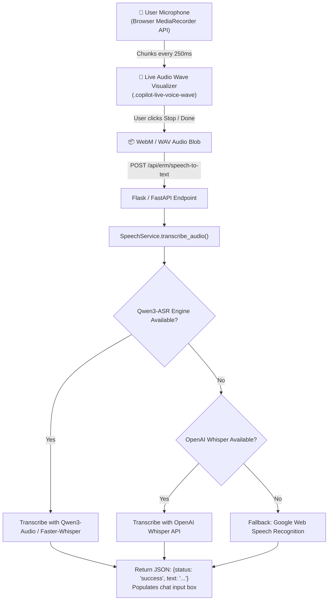

# 🎙️ Speech-to-Text Transcriber Service Documentation (`SpeechService`)

---

## 📌 1. Overview & Identity
- **Class Name:** [`SpeechService`](file:///d:/ERM/ERM_Copilot/services/speech_service.py#L22)
- **File Location:** [`d:/ERM/ERM_Copilot/services/speech_service.py`](file:///d:/ERM/ERM_Copilot/services/speech_service.py)
- **Role:** High-accuracy real-time speech recognition engine allowing plant engineers and managers to issue voice commands directly into ERM Copilot.
- **Supported Engines (Fallback Cascade):**
  1. **Primary:** `Qwen/Qwen3-Audio` / `Faster-Whisper` (Local / API inference).
  2. **Secondary:** OpenAI Whisper API / local `whisper-base`.
  3. **Tertiary:** Google Speech Recognizer.

---

## 🎙️ 2. Audio Pipeline & Real-Time Visualization



---

## 🌐 3. FastAPI / Flask Endpoint Integration

### Speech-to-Text Endpoint
- **HTTP Method:** `POST`
- **Route:** `/api/erm/speech-to-text`
- **Content-Type:** `multipart/form-data`
- **Controller File:** [`ERM_WEB_APP/app/controllers/web/auth_controller.py`](file:///d:/ERM/ERM_WEB_APP/app/controllers/web/auth_controller.py)
- **Form Data Field:** `audio` (file attachment, e.g. `prompt_audio.webm`)
- **Response Payload:**
```json
{
  "status": "success",
  "text": "Show top open high severity risks in Gas Processing",
  "engine_used": "Qwen3-ASR"
}
```

---

## 🛠️ 4. Frontend Voice Controller Integration
- **File Location:** [`ERM_WEB_APP/app/templates/partials/erm_copilot_widget.html`](file:///d:/ERM/ERM_WEB_APP/app/templates/partials/erm_copilot_widget.html#L1230-L1315)
- **Functions:**
  - `startVoiceRecording()`: Requests `navigator.mediaDevices.getUserMedia({ audio: true })` and starts recording with 250ms chunks.
  - `stopVoiceRecording()`: Stops tracks and dispatches FormData payload to `/api/erm/speech-to-text`.
  - `cleanupVoiceUI()`: Resets microphone pulse animation and restores user input placeholder.
