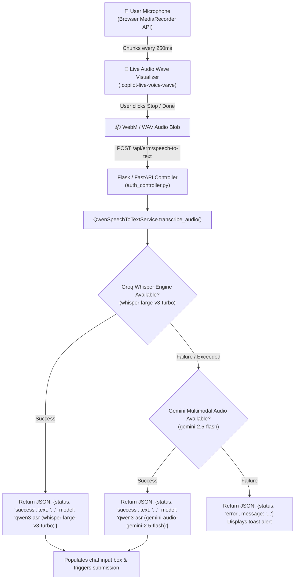

# 🎙️ Speech-to-Text Transcriber Service Documentation (`QwenSpeechToTextService`)

---

## 📌 1. Overview & Identity
- **Class Name:** [`QwenSpeechToTextService`](file:///d:/ERM/ERM_Copilot/services/speech_service.py#L25)
- **Singleton Instance:** [`qwen_speech_service`](file:///d:/ERM/ERM_Copilot/services/speech_service.py#L117)
- **File Location:** [`d:/ERM/ERM_Copilot/services/speech_service.py`](file:///d:/ERM/ERM_Copilot/services/speech_service.py)
- **Role:** High-accuracy real-time speech recognition engine allowing plant engineers, risk managers, and risk owners to issue voice commands directly into ERM Copilot.
- **Enterprise Acoustic Prompt Biasing:**
  - Includes enterprise context prompt hints to ensure risk codes (`RSK-GAS-056`, `RSK-IT-001`, `RSK-FIN-001`) and enterprise governance terminology (`Functional Head`, `Risk Manager`, `Risk Owner`, `Action Plan`, `Treatment`, `Heatmap`, `SCADA`) are transcribed without phonetic distortion.

---

## 🎙️ 2. Audio Pipeline & Real-Time Visualization



---

## ⚙️ 3. Method Specifications & API Contract

### Method: `transcribe_audio`
Transcribes raw audio bytes into text using the primary fast ASR model or falling back to multimodal audio.

- **Signature:**
  ```python
  def transcribe_audio(
      self,
      audio_bytes: bytes,
      filename: str = "audio.webm",
      content_type: str = "audio/webm",
      language: Optional[str] = "en"
  ) -> Dict[str, Any]
  ```

- **Parameters:**
  - `audio_bytes` (`bytes`): Raw binary audio payload received from the browser. Must be $\ge 100$ bytes.
  - `filename` (`str`, default `"audio.webm"`): Audio filename with extension.
  - `content_type` (`str`, default `"audio/webm"`): MIME format (`audio/webm`, `audio/wav`, `audio/mp4`).
  - `language` (`Optional[str]`, default `"en"`): Target language hint (`"en"`, `"hi"`, etc.).

- **Model Cascade Hierarchy:**
  1. **Groq Whisper Fast Tier:**
     - `whisper-large-v3-turbo` (sub-second ultra-low latency transcription)
     - `whisper-large-v3`
     - `distil-whisper-large-v3-en`
  2. **Gemini Multimodal Audio Tier:**
     - `gemini-2.5-flash`
     - `gemini-1.5-flash`

- **Success Response Schema:**
  ```json
  {
    "status": "success",
    "text": "Show top open high severity risks in Gas Processing",
    "model": "qwen3-asr (whisper-large-v3-turbo)"
  }
  ```

- **Error Response Schema:**
  ```json
  {
    "status": "error",
    "message": "Audio file is empty or too short."
  }
  ```

---

## 🌐 4. FastAPI & Flask Endpoint Integration

### Speech-to-Text Controller Route
- **HTTP Method:** `POST`
- **Route:** `/api/erm/speech-to-text`
- **Content-Type:** `multipart/form-data`
- **Controller File:** [`ERM_WEB_APP/app/controllers/web/auth_controller.py`](file:///d:/ERM/ERM_WEB_APP/app/controllers/web/auth_controller.py#L780)
- **Form Data Field:** `audio` (file attachment, e.g. `blob`)

```python
@auth_bp.route("/api/erm/speech-to-text", methods=["POST"])
def speech_to_text():
    if "audio" not in request.files:
        return jsonify({"status": "error", "message": "No audio file provided."}), 400
    file = request.files["audio"]
    audio_bytes = file.read()
    result = qwen_speech_service.transcribe_audio(
        audio_bytes=audio_bytes,
        filename=file.filename or "audio.webm",
        content_type=file.content_type or "audio/webm"
    )
    return jsonify(result)
```

---

## 🛠️ 5. Frontend Voice Controller Integration
- **File Location:** [`ERM_WEB_APP/app/templates/partials/erm_copilot_widget.html`](file:///d:/ERM/ERM_WEB_APP/app/templates/partials/erm_copilot_widget.html#L1230-L1315)
- **Functions:**
  - `startVoiceRecording()`: Requests `navigator.mediaDevices.getUserMedia({ audio: true })` and starts recording with 250ms data chunks. Activates the CSS wave animation.
  - `stopVoiceRecording()`: Stops microphone tracks, aggregates chunks into a `Blob`, and dispatches a `FormData` POST request to `/api/erm/speech-to-text`.
  - `cleanupVoiceUI()`: Resets microphone pulse animation and restores the chat input placeholder.
