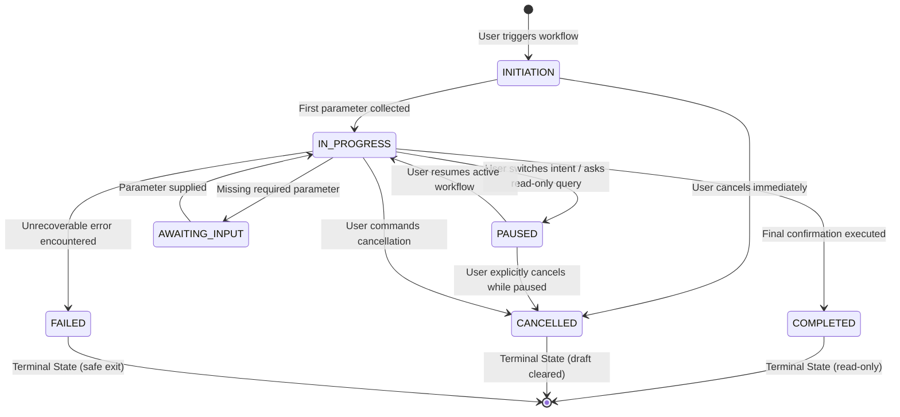

# 💾 Workflow Checkpointer & Concurrency Control (`PostgreSQLWorkflowCheckpointer`)

---

## 📌 1. Overview & Architecture

- **Class Name:** [`PostgreSQLWorkflowCheckpointer`](file:///d:/ERM/ERM_Copilot/workflow/checkpointer.py#L65)
- **File Location:** [`ERM_Copilot/workflow/checkpointer.py`](file:///d:/ERM/ERM_Copilot/workflow/checkpointer.py)
- **Authoritative Table Name:** **`ers.agent_workflow_checkpoints`**
- **Purpose:** Persistent, high-concurrency state store ensuring multi-turn conversational agents (Risk Creation Wizard, Approval Workflow, Treatment Management) persist intermediate draft states, survive application restarts, and prevent conflicting concurrent updates across distributed workers.

---

## 🗄️ 2. Authoritative PostgreSQL DDL & Indexes

```sql
CREATE TABLE IF NOT EXISTS ers.agent_workflow_checkpoints (
    workflow_id VARCHAR(64) PRIMARY KEY,
    session_id VARCHAR(128) NOT NULL,
    user_id VARCHAR(64) NOT NULL,
    workflow_type VARCHAR(64) NOT NULL,
    status VARCHAR(32) NOT NULL,
    current_step VARCHAR(64) NOT NULL,
    version INTEGER NOT NULL DEFAULT 1,
    collected_fields JSONB NOT NULL DEFAULT '{}'::jsonb,
    validation_errors JSONB NOT NULL DEFAULT '[]'::jsonb,
    history JSONB NOT NULL DEFAULT '[]'::jsonb,
    created_at TIMESTAMP WITH TIME ZONE DEFAULT CURRENT_TIMESTAMP,
    updated_at TIMESTAMP WITH TIME ZONE DEFAULT CURRENT_TIMESTAMP
);

-- Fast lookup by session and status
CREATE INDEX IF NOT EXISTS idx_workflow_checkpoints_session_status
ON ers.agent_workflow_checkpoints(session_id, status);

-- Fast lookup by user and status
CREATE INDEX IF NOT EXISTS idx_workflow_checkpoints_user_status
ON ers.agent_workflow_checkpoints(user_id, status);
```

### Table Column Details:
- **`workflow_id` (PK):** Unique identifier (e.g., `wf-10a2b3c4d5`).
- **`session_id`:** Client session identifier (e.g., `sess_web_7_abc123`).
- **`user_id`:** Authenticated user ID (e.g., `7`).
- **`workflow_type`:** Enum string: `RISK_CREATION`, `TREATMENT_MANAGEMENT`, `APPROVAL_GOVERNANCE`.
- **`status`:** Lifecycle status: `INITIATION`, `IN_PROGRESS`, `PAUSED`, `AWAITING_INPUT`, `COMPLETED`, `CANCELLED`, `FAILED`.
- **`version`:** Integer counter incremented on every save to enforce **Optimistic Concurrency Control**.
- **`collected_fields`:** JSONB dictionary holding all intermediate collected form fields.
- **`history`:** JSONB array logging timestamped state transitions and reasons.

---

## 🔒 3. Concurrency Control & Row-Level Locking

To guarantee consistency across multi-worker environments (e.g. multiple Uvicorn/Gunicorn processes), the checkpointer implements two distinct synchronization layers:

```mermaid
sequenceDiagram
    autonumber
    participant Worker1 as Worker Process A
    participant DB as PostgreSQL (ers.agent_workflow_checkpoints)
    participant Worker2 as Worker Process B

    Note over Worker1,Worker2: Both workers load checkpoint version = 1
    Worker1->>DB: BEGIN TRANSACTION (autocommit = False)
    Worker1->>DB: SELECT version FROM ers.agent_workflow_checkpoints WHERE workflow_id = 'wf-1' FOR UPDATE
    Note over DB: Row is locked by Worker 1
    Worker2->>DB: BEGIN TRANSACTION (autocommit = False)
    Worker2->>DB: SELECT version ... FOR UPDATE
    Note over Worker2: Worker 2 blocks waiting for lock release

    Worker1->>DB: UPDATE ... SET version = 2 WHERE workflow_id = 'wf-1' AND version = 1
    Worker1->>DB: COMMIT TRANSACTION
    Note over DB: Lock released; version is now 2

    Note over Worker2: Worker 2 acquires lock and reads version = 2
    Worker2->>Worker2: Expected version = 1, actual version = 2
    Worker2->>Worker2: Raise ConcurrencyConflictError!
    Worker2->>DB: ROLLBACK TRANSACTION
```

### Implementation Rules:
1. **Explicit Transaction Block (`conn.autocommit = False`):**
   - The connection pool must disable autocommit during save operations so the `SELECT ... FOR UPDATE` lock is held until the final `UPDATE` or `INSERT` statement commits.
2. **Optimistic Concurrency (`version` check):**
   - If `actual_version != expected_version`, the checkpointer aborts the update and raises [`ConcurrencyConflictError`](file:///d:/ERM/ERM_Copilot/workflow/checkpointer.py#L15).
3. **Safe Rollback:**
   - Any failure or concurrency conflict triggers `conn.rollback()` before releasing the connection back to the pool.

---

## 🔄 4. Legal Workflow State Transitions

The checkpointer strictly enforces legal state transitions via [`WorkflowStatus`](file:///d:/ERM/ERM_Copilot/workflow/checkpointer.py#L35):



### Transition Integrity Constraints:
- Attempting to transition from `COMPLETED` $\to$ `PAUSED` raises `IllegalStateTransitionError`.
- Terminal states (`COMPLETED`, `CANCELLED`, `FAILED`) cannot be re-opened; subsequent commands instantiate a new workflow instance.

---

## 💥 5. Crash Recovery & Simulated Failure Behavior

When an application process crashes or is restarted mid-turn:
1. **Uncommitted Mutations Rolled Back:** PostgreSQL automatically terminates pending in-flight transactions; no corrupted half-records exist.
2. **Prior Checkpoint Preserved:** The last successfully committed checkpoint remains intact in `ers.agent_workflow_checkpoints`.
3. **Automatic Resumption:** Upon user re-engagement, `load_active_for_session(session_id)` reloads the saved draft, allowing the user to continue from the exact step where they left off.
