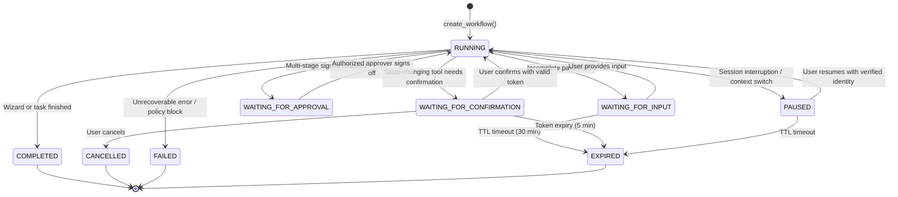

# Phase 1B — Production Architecture: Agentic State Management & PostgreSQL Checkpointing

**System:** MASS ERM Copilot  
**Document:** `docs/agentic/PHASE1_ARCHITECTURE.md`  
**Version:** 1.0.0-PROD  

---

## 1. Architectural Principles & Non-Negotiable Boundaries

1. **Incremental Upgrade:** The existing AI Harness, Master Orchestrator, Subagents, Tool Registry, and RBAC policies remain the single authoritative execution layer.
2. **Zero-Trust Checkpoints:** Checkpoints store conversational progression and minimal recovery references, **never** raw tokens, passwords, or cached authorization grants.
3. **Re-Evaluation on Resume:** Every workflow resumption re-authenticates the user, re-verifies RBAC permissions and department boundaries, and re-queries fresh authoritative business records from PostgreSQL.
4. **Deterministic Governance:** Autonomous planning is strictly bounded. The LLM or Planner can propose next steps, but all tool invocations and state changes pass through `ERMAIHarness` and `ToolRegistry`.
5. **Replay & Duplicate Write Prevention:** State-changing operations (`save_risk`, `add_risk_treatment`, `approve_or_reject_risk`) are guarded by idempotency keys and pre-write database reconciliation.

---

## 2. Shared Workflow State Contract

### 2.1 State Model (`AgentWorkflowState`)

```
┌────────────────────────────────────────────────────────────────────────┐
│                        AgentWorkflowState                              │
├────────────────────────────────────────────────────────────────────────┤
│ • workflow_id: str (UUIDv4)                                            │
│ • conversation_id: str                                                 │
│ • session_id: str ({user_id}::{session_id})                           │
│ • workflow_type: WorkflowType (Enum)                                   │
│ • workflow_status: WorkflowStatus (Enum)                               │
│ • owner_user_id: str (Verified Authenticated Owner)                    │
│ • owner_role: str (Canonical ERM Role)                                 │
│ • dept_id: Optional[int]                                               │
│ • dept_name: Optional[str]                                             │
│ • current_agent: str                                                   │
│ • current_step: str                                                    │
│ • step_count: int (Incremented each turn)                              │
│ • max_steps: int (Default: 15)                                         │
│ • risk_id: Optional[str] (e.g., "RSK-GAS-087")                         │
│ • collected_fields: Dict[str, Any]                                     │
│ • missing_fields: List[str]                                            │
│ • pending_action: Optional[Dict[str, Any]]                             │
│ • last_completed_step: Optional[str]                                   │
│ • last_error_code: Optional[str]                                       │
│ • state_version: int (Optimistic locking sequence)                     │
│ • created_at / updated_at / expires_at: datetime                       │
│ • idempotency_key: Optional[str]                                       │
└────────────────────────────────────────────────────────────────────────┘
```

### 2.2 Workflow Statuses & Legal State Transition Machine



### 2.3 Transition Validation Rules
- **Terminal States:** `COMPLETED`, `CANCELLED`, `FAILED`, and `EXPIRED` are terminal. No transitions out of terminal states are allowed.
- **Confirmation Safety:** An unconfirmed workflow cannot move to `COMPLETED` if `pending_action` contains an unexecuted state-changing operation.
- **Optimistic Locking:** Every state update increments `state_version`. Checkpointer rejects updates if database `state_version != expected_version`.

---

## 3. PostgreSQL Checkpointing Backend

### 3.1 Database Table Schema (`ers.agent_workflow_checkpoints`)

```sql
CREATE TABLE IF NOT EXISTS ers.agent_workflow_checkpoints (
    workflow_id VARCHAR(64) PRIMARY KEY,
    conversation_id VARCHAR(64) NOT NULL,
    session_id VARCHAR(128) NOT NULL,
    owner_user_id VARCHAR(64) NOT NULL,
    owner_role VARCHAR(64) NOT NULL,
    dept_id INT,
    workflow_type VARCHAR(64) NOT NULL,
    workflow_status VARCHAR(64) NOT NULL,
    current_agent VARCHAR(64) NOT NULL,
    current_step VARCHAR(64) NOT NULL,
    state_version INT NOT NULL DEFAULT 1,
    state_payload JSONB NOT NULL,
    created_at TIMESTAMP WITH TIME ZONE NOT NULL,
    updated_at TIMESTAMP WITH TIME ZONE NOT NULL,
    expires_at TIMESTAMP WITH TIME ZONE NOT NULL
);

CREATE INDEX IF NOT EXISTS idx_workflow_session ON ers.agent_workflow_checkpoints (session_id, workflow_status);
CREATE INDEX IF NOT EXISTS idx_workflow_owner ON ers.agent_workflow_checkpoints (owner_user_id);
CREATE INDEX IF NOT EXISTS idx_workflow_expires ON ers.agent_workflow_checkpoints (expires_at);
```

### 3.2 Security & Multi-Tenancy Rules for Checkpoints
1. **Ownership Isolation:** `load_checkpoint(workflow_id, context)` strictly validates `context.user_id == checkpoint.owner_user_id` (or `Super Admin`). Attempting to load another user's checkpoint raises `AuthorizationError`.
2. **Department Boundary Isolation:** For department-scoped roles (`Risk Owner`, `Functional Head`), `context.dept_id` must match `checkpoint.dept_id`.
3. **Payload Sanitization:** No authorization tokens, API keys, passwords, or full database snapshots are stored in `state_payload`.

---

## 4. Bounded Autonomous Planner

The Master Orchestrator utilizes `BoundedPlanner` to select among valid next actions:

### 4.1 Supported Decision Types
1. `CALL_READ_TOOL`: Execute read-only tool (e.g., `get_risk_audit_trail`, `search_risks`).
2. `DELEGATE_TO_AGENT`: Handoff to specialized subagent (`RiskCreationAgent`, `TreatmentManagementAgent`, `ApprovalWorkflowAgent`).
3. `ASK_USER`: Prompt user for missing fields or required clarification.
4. `WAIT_FOR_CONFIRMATION`: Render confirmation prompt with action fingerprint and wait for user button click or token.
5. `WAIT_FOR_APPROVAL`: Pause workflow until governance tier sign-off occurs.
6. `RESUME_WORKFLOW`: Restore saved workflow and advance to next incomplete step.
7. `COMPLETE`: Finalize task, invalidate cache, format output.
8. `FAIL_SAFELY`: Halt on guardrail block, policy violation, or exhausted step limit.

### 4.2 Planning Bounds & Safety Invariants
- **Step Count Limit:** Hard limit of `max_steps = 15`. If exceeded, workflow transitions to `FAILED` with `StepLimitExceededError`.
- **Circular Delegation Prevention:** Tracks agent handoff history `[agent1, agent2, agent1, agent2]`. If a circular loop of depth $\ge 3$ is detected, workflow halts safely.
- **Tool Existence Check:** Planner can only select tools registered in `ToolRegistry`. Hallucinated tool names trigger `FAIL_SAFELY`.

---

## 5. Human-in-the-Loop & Resume Protocol

When a workflow resumes from `WAITING_FOR_CONFIRMATION` or `PAUSED`:

```
User Message / Token
        │
        ▼
1. Authenticate Request → HarnessContext
        │
        ▼
2. Verify Workflow Ownership (context.user_id == state.owner_user_id)
        │
        ▼
3. Re-Evaluate Role & Department Scope (context.user_role, context.dept_id)
        │
        ▼
4. Re-Verify Tool Permission via ToolRegistry.get(tool_name)
        │
        ▼
5. Re-Query Live Database (Ensure risk / stage still exists in target state)
        │
        ▼
6. Validate Confirmation Token & Fingerprint (ConfirmationManager)
        │
        ▼
7. Execute Tool & Save State-Change → Persist Checkpoint (COMPLETED)
```

---

## 6. Idempotency & Recovery Protocol

For state-changing operations:
1. **Idempotency Key:** Deterministic hash `SHA256(workflow_id + step_name + action_name + args)`.
2. **Pre-Write Check:**
   - Before executing `save_risk`: Checks `erm_db.search_risks(keyword=risk_name, dept_id=dept_id)`. If record exists with matching parameters created within last 5 minutes, re-uses existing `risk_id` instead of inserting duplicate.
   - Before executing `approve_or_reject_risk`: Checks `erm_db.get_risk_audit_trail(risk_id)`. If stage already transitioned, acknowledges success without re-executing.
   - Before executing `add_risk_treatment`: Checks if treatment with identical `action_plan` exists for `risk_register_id`.
