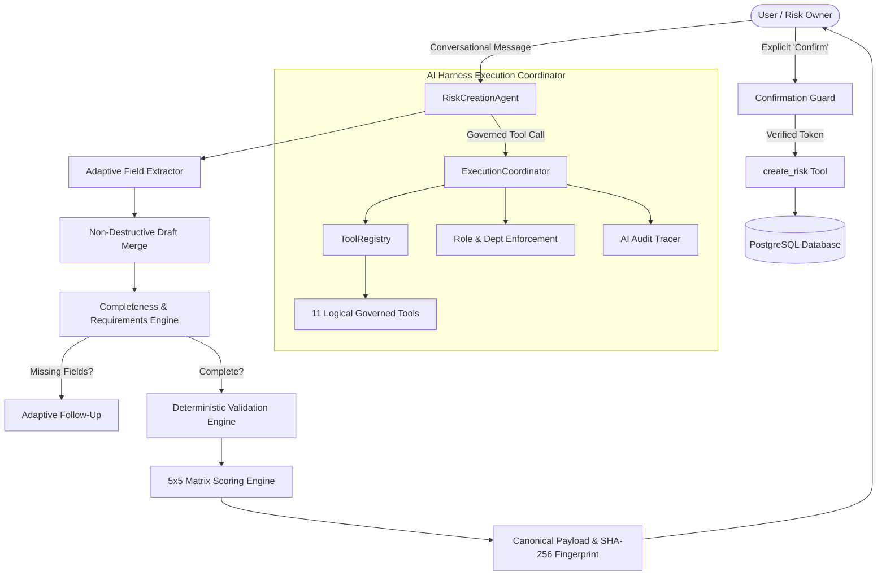
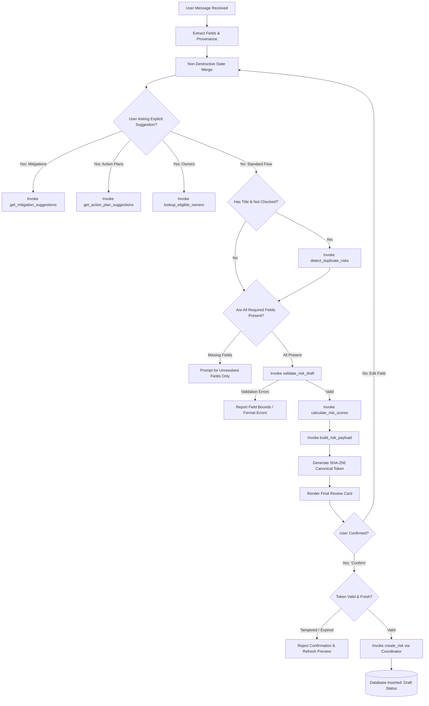

# Deep-Level Architecture & Technical Specification: Goal-Driven Risk Creation Agent

## 1. Executive Summary & Core Philosophy

The **Goal-Driven Risk Creation Agent** is an enterprise-grade, conversational risk engineering assistant implemented inside the ERM Copilot ecosystem. 

Unlike traditional chatbot assistants that force users through rigid, hard-coded questionnaires (e.g., `Step 1 of 10`, `Step 2 of 10`), this agent operates on a **Goal-Driven, State-Convergent Architecture**:
- **Any-Order Input**: Accepts any subset or the entirety of risk parameters in a single conversational turn.
- **Selective Follow-Up**: Computes mathematical completeness against enterprise risk criteria, prompting **only** for unresolved mandatory fields.
- **Governed Tool Layer**: All actions, database queries, mathematical calculations, and suggestion engines are executed through a central **AI Harness** (`ExecutionCoordinator` and `ToolRegistry`).
- **Zero Hallucination / Zero Silent Writes**: Ratings and matrix computations are strictly deterministic. Database persistence cannot be triggered by LLM reasoning alone and strictly requires cryptographic, human-reviewed confirmation.

---

## 2. High-Level System Architecture



---

## 3. The 11 Governed Tools Catalog

Every capability accessible to the agent is registered with explicit Pydantic validation schemas, role constraints, and audit instrumentation.

### 1. `resolve_reference_data`
- **Purpose**: Authoritative reference data retrieval (categories, status options, assessment scales, and matrix thresholds).
- **Schema**:
  - `dataset`: `Literal['all', 'assessment_criteria', 'departments', 'status']`
- **Allowed Roles**: All authenticated roles (including `Auditor`).
- **Department Boundary**: Enterprise-wide.
- **Handler**: `_handle_resolve_reference_data` querying `erm_db.get_criteria_matrix()`.

### 2. `lookup_eligible_owners`
- **Purpose**: Governed search for valid personnel eligible to be assigned as Co-Owners or Action Owners.
- **Schema**:
  - `owner_type`: `Literal['action_owner', 'co_owner']`
  - `search_term`: `Optional[str]` (name or email prefix)
  - `dept_id`: `Optional[int]`
- **Allowed Roles**: `Risk Owner`, `Functional Head`, `Risk Manager`, `Risk Head`, `Admin`, `Super Admin`.
- **Department Boundary**:
  - `co_owner`: **Enterprise-wide** (can be selected across any department).
  - `action_owner`: **Department-isolated** for standard users (`caller_dept_id`); cross-department filtering is permitted only for enterprise roles (`Admin`, `Risk Manager`, `Risk Head`).
- **Handler**: `_handle_lookup_eligible_owners` calling `erm_db.get_department_action_owners()` and `erm_db.get_all_users_for_co_owner()`.

### 3. `get_mitigation_suggestions`
- **Purpose**: Context-aware mitigation strategy recommendations tailored to the hazard description.
- **Schema**:
  - `risk_title`: `str` (min 3 chars)
  - `risk_description`: `Optional[str]`
  - `hazard_category`: `Optional[str]`
  - `include_historical`: `bool = True`
- **Allowed Roles**: `Risk Owner`, `Functional Head`, `Risk Manager`, `Risk Head`, `Admin`, `Super Admin`.
- **Logic**: Combines curated domain templates from `static_suggestion_provider` with historical department treatments (`erm_db.get_historical_treatments`).
- **Department Boundary**: Historical matches are scoped to `caller_dept_id`.

### 4. `get_action_plan_suggestions`
- **Purpose**: Recommended time-bound implementation steps based on accepted mitigation strategies.
- **Schema**:
  - `risk_title`: `str` (min 3 chars)
  - `mitigation_strategy`: `Optional[str]`
  - `risk_description`: `Optional[str]`
- **Allowed Roles**: `Risk Owner`, `Functional Head`, `Risk Manager`, `Risk Head`, `Admin`, `Super Admin`.
- **Handler**: `_handle_get_action_plan_suggestions`.

### 5. `detect_duplicate_risks`
- **Purpose**: Advisory duplicate hazard detection to prevent redundant risk registrations.
- **Schema**:
  - `risk_title`: `str` (min 3 chars)
  - `dept_id`: `Optional[int]`
  - `similarity_threshold`: `float = 0.65`
- **Allowed Roles**: `Risk Owner`, `Functional Head`, `Risk Manager`, `Risk Head`, `Admin`, `Super Admin`.
- **Key Invariant**: **Advisory only**. A database error or timeout returns an explicit error status; it is never fabricated into "verified unique".

### 6. `validate_risk_draft`
- **Purpose**: Deterministic validation of all entered draft parameters against business rules prior to scoring.
- **Schema**:
  - `draft_fields`: `Dict[str, Any]`
- **Allowed Roles**: `Risk Owner`, `Functional Head`, `Risk Manager`, `Risk Head`, `Admin`, `Super Admin`.
- **Rules Checked**: Rating ranges (`1..5`), positive financial impact, minimum description length, target date formatting (`YYYY-MM-DD`).

### 7. `calculate_risk_scores`
- **Purpose**: Mathematical computation of Inherent and Residual risk scores and matrix band mapping.
- **Schema**:
  - `likelihood`: `int` (1..5)
  - `impact`: `int` (1..5)
- **Allowed Roles**: All roles except `Auditor`.
- **Logic**: Strict $Score = Likelihood \times Impact$ mapped to matrix bands:
  - `1-3`: Low (Green)
  - `4-6`: Medium (Yellow)
  - `8-12`: High (Amber)
  - `15-25`: Critical (Red)

### 8. `build_risk_payload`
- **Purpose**: Assembles the sanitized, immutable `FinalRiskPayload` structure from the completed draft and trusted server context.
- **Schema**:
  - `session_id`: `str`
  - `draft`: `Dict[str, Any]`
- **Security Invariant**: Pins `risk_owner_id = context.user_id` and `dept_id = context.dept_id` for standard users.

### 9. `create_risk`
- **Purpose**: Official persistence of the validated risk record into PostgreSQL.
- **Schema**: `CreateRiskInput` (enforcing all database column types).
- **Execution Invariants**:
  - **Confirmation Gate**: Requires an active, non-expired `PENDING` confirmation token.
  - **Anti-Retry Policy**: Classified as `is_state_changing=True, is_idempotent=False`. The coordinator explicitly disables automatic retries to prevent duplicate database insertions on network timeouts.
  - **Anti-Spoofing**: Standard users cannot supply a foreign `dept_id`; server-verified `context.dept_id` overrides any payload argument.

### 10. `get_dropdown_options`
- **Purpose**: Backward-compatible reference data helper for UI dropdown elements.

### 11. `check_risk_duplicates`
- **Purpose**: Alias / legacy router targeting the primary duplicate detection engine.

---

## 4. Dynamic Tool Selection & Decision Logic Tree

The agent determines its next action dynamically upon every user message through a deterministic decision pipeline:



### Key Decision Rules:
1. **Bypass Unnecessary Questions**: If the user provides acceptable mitigation and action plan text in the prompt, suggestion tools are **completely skipped**.
2. **Selective Question Formulation**: Follow-up queries are generated strictly from `completeness.missing_fields`. Resolved fields are acknowledged and never re-asked.
3. **Draft Mutation Invalidation**: Any conversational modification to an existing draft immediately invalidates any previously generated confirmation token.

---

## 5. Security & Governance Invariants

### 1. Trusted Server-Side Identity (Anti-Spoofing)
The agent never trusts user prompts or LLM generated payloads for identity parameters. 
- `user_id` and `dept_id` are injected by `HarnessContext` from authenticated session headers.
- If a standard `Risk Owner` in Department 1 passes `dept_id: 2` in a message, `ExecutionCoordinator.execute_tool` overrides it with `1`.

### 2. Department Boundary Enforcement
| Role | Action Owner Scope | Department Assignment on Create | Cross-Department Lookup |
| :--- | :--- | :--- | :--- |
| **Risk Owner** | Caller's Department only | Caller's Department only | Co-owner only |
| **Functional Head** | Caller's Department only | Caller's Department only | Co-owner only |
| **Risk Manager** | Enterprise-wide | Permitted cross-department | Enterprise-wide |
| **Risk Head** | Enterprise-wide | Permitted cross-department | Enterprise-wide |
| **Admin / Super Admin** | Enterprise-wide | Permitted cross-department | Enterprise-wide |
| **Auditor** | Read-Only | Denied (`AuthorizationError`) | Read-Only |

### 3. Confirmation Token & Hash Integrity
- When a preview is generated, the agent computes a canonical serialization:
  $$\text{Hash} = \text{SHA-256}(\text{CanonicalPayload}(\text{draft}))$$
- When the user sends `"Confirm"`, the harness verifies:
  1. Token exists and belongs to the active session.
  2. Token status is `PENDING` (not `EXECUTED` or `EXPIRED`).
  3. Elapsed time is $< 15\text{ minutes}$.
  4. SHA-256 hash of the currently submitted payload matches the token hash exactly.
- Once executed, the token transitions to `EXECUTED`. Any subsequent duplicate request is rejected as a replay attempt.

---

## 6. Durable Session State & Audit Tracing

Every `RiskCreationSession` maintains a durable audit history:
- **`field_provenance`**: Tracks whether each field was provided by the user, adopted from an AI suggestion, or derived by deterministic calculation.
- **`tool_call_history`**: A bounded list of all tool executions with timestamps, tool names, sanitized arguments, execution status, and run IDs.

```python
# Structure of an audit record in session.tool_call_history
{
    "tool_name": "create_risk",
    "arguments": {
        "risk_name": "Unpatched API Gateway",
        "dept_id": 1,
        "risk_owner_id": 101,
        "inherent_score": 12
    },
    "success": True,
    "timestamp": "2026-10-22T05:54:18Z",
    "run_id": "run-af9c43870f2f"
}
```

---

## 7. Test Verification & Proof of Correctness

The architecture is covered by **123 automated tests** across 8 test suites:
- `test_phase1_risk_creation.py`: Adaptive extraction, draft merging, and completeness.
- `test_phase2_slice1.py`: Governed reference data and eligible owner lookups.
- `test_phase2_slice2.py`: Governed mitigation and action plan suggestions.
- `test_phase2_slice3.py`: Duplicate risk detection and Auditor RBAC boundaries.
- `test_phase3_validation_payload.py`: Deterministic validation, scoring, and payload generation.
- `test_phase4a_tool_layer_agent.py`: Tool registry wiring and agent coordinator integration.
- `test_phase4b_verification_hardening.py`: Hardening against replay, tampering, department spoofing, and residual questionnaires.
- `test_risk_owner_scenarios.py`: End-to-end Risk Owner workflows (one-shot, multi-turn, anti-spoofing).

To run the complete suite:
```powershell
d:\ERM\myenv\Scripts\python.exe -m unittest discover -s ERM_Copilot/tests -p "test_*.py"
```
